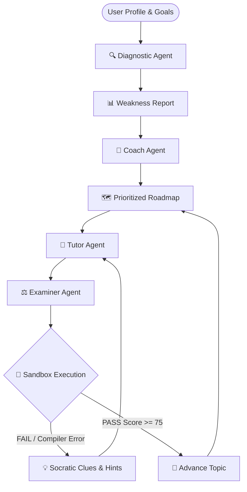
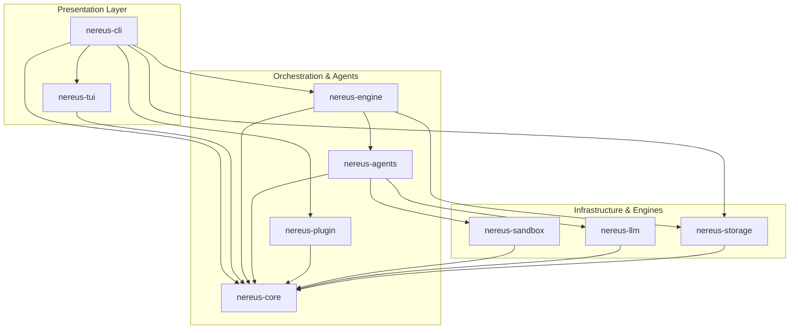

<div align="center">

<a href="https://github.com/nereuslabs/nereus">
  
</a>

# 🌊 Nereus

<a href="https://github.com/nereuslabs/nereus">
  
</a>

<p align="center">
  <strong>Honest, adaptive, and execution-driven learning — powered by an algebraic finite state automaton.</strong>
</p>

<!-- Badges -->
<p align="center">
  <a href="https://www.rust-lang.org/"></a>
  <a href="LICENSE"></a>
  <a href="https://ratatui.rs/"></a>
  <a href="https://github.com/nereuslabs/nereus/actions/workflows/ci.yml"></a>
  <a href="https://github.com/nereuslabs/nereus/releases"></a>
</p>

<!-- Quick Navigation -->
<p align="center">
  <a href="#-overview">Overview</a> •
  <a href="#-terminal-cockpit-tui">Terminal Cockpit</a> •
  <a href="#-architecture--the-4-agents">Architecture</a> •
  <a href="#-quick-start">Quick Start</a> •
  <a href="#-features">Features</a> •
  <a href="#-roadmap">Roadmap</a> •
  <a href="#-contributing">Contributing</a>
</p>

</div>

---

## ⚡ Overview

Most AI learning tools act like flattering chatbots that dump unearned solutions into your lap. **Nereus is different.**

Named after the ancient Greek sea elder who guided navigators with unflinching honesty, **Nereus 2.0** is an **autonomous, terminal-native AI coding cockpit** built from scratch in **pure Rust**:

* 🧭 **Adaptive Diagnostic Engine**: Tests your fundamentals before touching a roadmap.
* 🛡️ **Algebraic State Automaton**: Exhaustive compile-time transitions — no fragile graph pickling or unpredictable loops.
* 🧪 **Execution-Driven Validation**: We compile and run your code in a sandbox, then pass real compiler/test feedback to the AI.
* 💡 **Strict Socratic Mentorship**: The examiner never gives away answers; it highlights conceptual gaps and prompts you to solve them yourself.

> [!TIP]
> **Zero API Tokens Required for Demos & CI!**  
> Nereus ships with a deterministic `StubLLMClient` that allows 100% of the learning automaton, TUI, and test suites to run completely offline without an API key or internet connection.

---

## 🎮 Terminal Cockpit (TUI)

```text
 ┌── 🗺️ Roadmap: Rust Concurrency ──────────┬── 🧪 Challenge: Tokio MPSC Channel ──────┐
 │ [✔] 1. Threads, Mutex & Arc              │ Task: Implement a background worker task  │
 │ [●] 2. Async Runtime & Tokio Channels ◄──┤ that consumes messages from an mpsc       │
 │ [ ] 3. Select! and Cancellation          │ receiver with a timeout of 500ms.         │
 │ [ ] 4. Pinning, Streams & Sinks          │ Return Err(WorkerTimeout) on deadline.    │
 ├── 💡 Socratic Guidance ──────────────────┼── 📝 Code Editor / Submission ────────────┤
 │ > 🗼 Lighthouse Hint:                    │ pub async fn start_worker(                │
 │ "Notice compiler error E0382: use of     │     mut rx: mpsc::Receiver<Job>,          │
 │ moved value 'tx'. How does mpsc differ   │ ) -> Result<(), WorkerError> {            │
 │ from broadcast when cloning senders?"    │     while let Ok(job) =                   │
 │                                          │         tokio::time::timeout(..).await {  │
 │ Verdict: RETRY (Score: 65/100)           │             // Your solution here         │
 └──────────────────────────────────────────┴───────────────────────────────────────────┘
```

---

## 🏗️ Architecture & The 4 Agents

Instead of an unstructured chat loop, Nereus orchestrates an algebraic finite state machine:



### The 4 Specialized Agents

| Agent | Icon | Role & Responsibility |
| :--- | :---: | :--- |
| **Diagnostic** | 🔍 | Probes the learner's baseline via adaptive multi-choice and micro-coding questions. Outputs `WeaknessReport`. |
| **Coach** | 🧭 | Assembles milestones, deadlines, and prerequisites into an ordered `Roadmap` that targets weak areas first. |
| **Tutor** | 📖 | Synthesizes concise theory and delivers hands-on coding challenges. On retry, generates targeted revision modules. |
| **Examiner** | ⚖️ | Compiles and executes code in a sandbox, evaluates assertions, scores performance, and guides debugging. |

### The 9-Crate Modular Workspace



```
nereus/
├── crates/
│   ├── nereus-core/      # Pure domain models, FSM enums, core subsystem traits (Zero I/O)
│   ├── nereus-engine/    # State transition orchestrator & Socratic threshold formula
│   ├── nereus-agents/    # Diagnostic, Coach (DAG sort), Tutor, and Examiner implementations
│   ├── nereus-llm/       # Stub, OpenRouter, and Anthropic clients with structured retry loop
│   ├── nereus-sandbox/   # Host scratchpad & Wasmtime in-memory runner with fuel metering
│   ├── nereus-storage/   # SQLite WAL mode persistence with schema migrations
│   ├── nereus-tui/       # Ratatui terminal cockpit & animated Socratic Lighthouse
│   ├── nereus-plugin/    # ModuleRegistry container for Tier-1 runtime hot-switching
│   └── nereus-cli/       # Main unified executable binary
```

---

## 🚀 Quick Start

### 1. Prerequisites
Ensure you have the Rust toolchain installed (MSRV 1.78+):
```bash
curl --proto '=https' --tlsv1.2 -sSf https://sh.rustup.rs | sh
```

### 2. Building & Testing
```bash
# Clone the repository
git clone https://github.com/nereuslabs/nereus.git
cd nereus

# Run all 124 unit and integration tests (zero API tokens required)
cargo test --workspace

# Build the release binary
cargo build --release
```

### 3. Launching the Cockpit
```bash
# Launch in Offline Deterministic Demo Mode
cargo run -p nereus-cli -- --offline --demo

# Launch with live OpenRouter or Anthropic AI inference
export NEREUS_API_KEY="sk-..."
cargo run -p nereus-cli -- --skill "Rust" --level "intermediate"
```

<details>
<summary><strong>⚙️ CLI Options & Flags</strong></summary>

```text
Usage: nereus [OPTIONS]

Options:
  -s, --skill <SKILL>          Target programming language or framework [default: Rust]
  -l, --level <LEVEL>          Current skill level (beginner | intermediate | advanced)
  -g, --goal <GOAL>            Primary learning objective
      --diagnostic             Force diagnostic quiz before roadmap generation
      --offline                Run in deterministic offline mode (Stub LLM)
      --session-id <UUID>      Resume a previously saved learning session
      --db <PATH>              Custom path to SQLite session database [default: ~/.nereus/nereus.db]
  -h, --help                   Print help information
  -V, --version                Print version information
```
</details>

---

## ✨ Features

- [x] **Sub-millisecond Cold Starts**: Written in Rust; launches instantly with negligible memory footprint (~15MB RAM).
- [x] **Algebraic State Engine**: Complete reliability with state transitions modeled via exhaustive Rust enums.
- [x] **Hermetic Testing**: Over 100+ unit and integration tests run in milliseconds without network access.
- [x] **Multi-Provider LLM Client**: Built-in support for OpenRouter, Anthropic Claude, Ollama, and deterministic stub.
- [x] **Persistent Session Storage**: SQLite backend stores progress, weak spots, and submission history across restarts.

---

## 🗺️ Roadmap to v2.0-stable

- [x] **Phase 0**: Architecture RFC & Domain Model Design ([Specification](docs/ARCHITECTURE.md)).
- [x] **Phase P0**: 9-Crate Modular Cargo Workspace Scaffold & ModuleRegistry ([Guide](docs/MODULAR_FRAMEWORK.md)).
- [x] **Phase 1**: Algebraic State Machine & Event Loop implementation (`nereus-engine`).
- [x] **Phase 2**: Multi-provider LLM runtime (`StubLLMClient`, `OpenRouterClient`, `AnthropicClient`).
- [x] **Phase 3**: Diagnostic, Coach (DAG sort), Tutor, and Socratic Examiner agents (`nereus-agents`).
- [x] **Phase 4**: Ratatui Terminal User Interface (TUI) cockpit & Animated Socratic Lighthouse (`nereus-tui`).
- [x] **Phase 5**: WebAssembly (WASM) in-memory code execution sandbox via `wasmtime` (`nereus-sandbox`).
- [x] **Phase 6**: SQLite WAL session persistence & declarative schema migrations (`nereus-storage`).
- [x] **Phase CI**: Automated GitHub Actions CI/CD Quality Gates (`cargo fmt`, `clippy -D warnings`, test suites).
- [ ] **Phase MVP**: Interactive full-screen terminal event loop, diagnostic quiz widget, and bundled Rust curriculum.
- [ ] **Phase 7**: Dynamic shared library (`.dylib` / `.so`) Tier-2 hot-reloading host.
- [ ] **Phase 8**: Single-binary packaging & Homebrew tap distribution.

---

## 🤝 Contributing

We welcome contributions from developers worldwide!

1. All documentation, commits, and discussions are conducted in **English**.
2. Commits strictly follow the **[Conventional Commits](https://www.conventionalcommits.org/)** specification:
   - `feat:` New features or agent capabilities
   - `fix:` Bug fixes or state transition corrections
   - `docs:` Documentation improvements
   - `refactor:` Code improvements without behavioral changes
   - `test:` Offline integration tests & benchmarks
3. Quality gates:
   ```bash
   cargo fmt --check
   cargo clippy --all-targets -- -D warnings
   cargo test
   ```

See [CONTRIBUTING.md](CONTRIBUTING.md) for full details.

---

## 🌟 Star History

<p align="center">
  <a href="https://star-history.com/#nereuslabs/nereus&Date">
    
  </a>
</p>

---

## 📜 License

Nereus 2.0 is licensed under the permissive **[MIT License](LICENSE)**.  
Copyright (c) 2026 Nereus Labs.

<div align="center">
  <sub>Built with precision and care by Nereus Labs. May your voyages be guided by truth. 🌊</sub>
</div>
