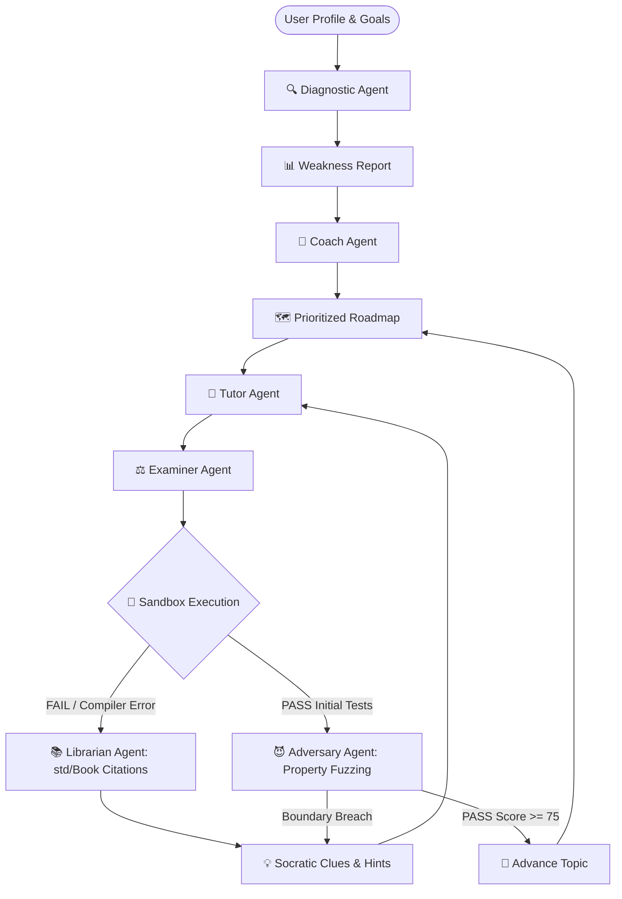
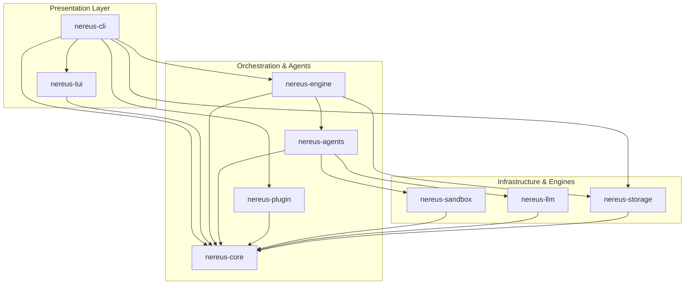

<div align="center">

<a href="https://github.com/nereuslabs/nereus">
  
</a>

# 🌊 Nereus

<a href="https://github.com/nereuslabs/nereus">
  
</a>

<p align="center">
  <strong>Honest, adaptive, and execution-driven learning — powered by an algebraic finite state automaton.</strong>
</p>

<!-- Badges -->
<p align="center">
  <a href="https://www.rust-lang.org/"></a>
  <a href="LICENSE"></a>
  <a href="https://ratatui.rs/"></a>
  <a href="https://github.com/nereuslabs/nereus/actions/workflows/ci.yml"></a>
  <a href="https://github.com/nereuslabs/nereus/releases"></a>
</p>

<!-- Quick Navigation -->
<p align="center">
  <a href="#-overview">Overview</a> •
  <a href="#-terminal-cockpit-tui">Terminal Cockpit</a> •
  <a href="#-architecture--the-6-specialized-agents">Architecture</a> •
  <a href="#-quick-start">Quick Start</a> •
  <a href="#-key-capabilities">Features</a> •
  <a href="#-roadmap">Roadmap</a> •
  <a href="#-contributing">Contributing</a>
</p>

</div>

---

## ⚡ Overview

Most AI learning tools act like flattering chatbots that dump unearned solutions into your lap. **Nereus is different.**

Named after the ancient Greek sea elder who guided navigators with unflinching honesty, **Nereus 2.0** is an **autonomous, terminal-native AI coding cockpit** built from scratch in **pure Rust**:

* 🧭 **Adaptive Diagnostic Engine**: Tests your fundamentals before touching a roadmap.
* 🛡️ **Algebraic State Automaton**: Exhaustive compile-time transitions — no fragile graph pickling or unpredictable loops.
* 🧪 **Execution-Driven Validation**: We compile and run your code in a sandbox, then pass real compiler/test feedback to the AI.
* 💡 **Strict Socratic Mentorship**: The examiner never gives away answers; it highlights conceptual gaps and prompts you to solve them yourself.

> [!TIP]
> **Zero API Tokens Required for Demos & CI!**  
> Nereus ships with a deterministic `StubLLMClient` that allows 100% of the learning automaton, TUI, and test suites to run completely offline without an API key or internet connection.

---

## 🎮 Terminal Cockpit (TUI)

```text
 ┌── 🗺️ Roadmap: Rust Concurrency ──────────┬── 🧪 Challenge: Tokio MPSC Channel ──────┐
 │ [✔] 1. Threads, Mutex & Arc              │ Task: Implement a background worker task  │
 │ [●] 2. Async Runtime & Tokio Channels ◄──┤ that consumes messages from an mpsc       │
 │ [ ] 3. Select! and Cancellation          │ receiver with a timeout of 500ms.         │
 │ [ ] 4. Pinning, Streams & Sinks          │ Return Err(WorkerTimeout) on deadline.    │
 ├── 💡 Socratic Guidance ──────────────────┼── 📝 Code Editor / Submission ────────────┤
 │ > 🗼 Lighthouse Hint:                    │ pub async fn start_worker(                │
 │ "Notice compiler error E0382: use of     │     mut rx: mpsc::Receiver<Job>,          │
 │ moved value 'tx'. How does mpsc differ   │ ) -> Result<(), WorkerError> {            │
 │ from broadcast when cloning senders?"    │     while let Ok(job) =                   │
 │                                          │         tokio::time::timeout(..).await {  │
 │ Verdict: RETRY (Score: 65/100)           │             // Your solution here         │
 └──────────────────────────────────────────┴───────────────────────────────────────────┘
```

---

## 🏗️ Architecture & The 6 Specialized Agents

Instead of an unstructured chat loop, Nereus orchestrates an algebraic finite state machine:



### The 6 Specialized Agents

| Agent | Icon | Role & Responsibility |
| :--- | :---: | :--- |
| **Diagnostic** | 🔍 | Probes the learner's baseline via adaptive multi-choice and micro-coding questions. Outputs `WeaknessReport`. |
| **Coach** | 🧭 | Assembles milestones, deadlines, and prerequisites into an ordered `Roadmap` that targets weak areas first. |
| **Tutor** | 📖 | Synthesizes concise theory and delivers hands-on coding challenges. On retry, generates targeted revision modules. |
| **Examiner** | ⚖️ | Compiles and executes code in a sandbox, evaluates assertions, scores performance, and guides debugging. |
| **Librarian** | 📚 | Offline semantic retriever for the Rust standard library and Rustonomicon; maps compiler diagnostics (`E0382`, `E0597`) to official citations. |
| **Adversary** | 😈 | Property-based educational fuzzer; synthesizes boundary cases, arithmetic overflow stress, and concurrency race conditions. |

### The 9-Crate Modular Workspace



```
nereus/
├── crates/
│   ├── nereus-core/      # Pure domain models, FSM enums, core subsystem traits (Zero I/O)
│   ├── nereus-engine/    # State transition orchestrator & Socratic threshold formula
│   ├── nereus-agents/    # The 6 Socratic agents (Diagnostic, Coach, Tutor, Examiner, Librarian, Adversary)
│   ├── nereus-llm/       # OpenRouter, Anthropic, Ollama, Candle (local), and deterministic Stub
│   ├── nereus-sandbox/   # Host scratchpad, Wasmtime WASM runner, and syn AST anti-pattern analyzer
│   ├── nereus-storage/   # SQLite WAL mode persistence, FTS5 full-text search, and schema migrations
│   ├── nereus-tui/       # Ratatui terminal cockpit, undo/redo buffer, search modal & Socratic Lighthouse
│   ├── nereus-plugin/    # ModuleRegistry hot-switching container & Wasm Component Model host
│   └── nereus-cli/       # Main unified executable binary
```

---

## 🚀 Quick Start

### 1. Prerequisites
Ensure you have the Rust toolchain installed (MSRV 1.78+):
```bash
curl --proto '=https' --tlsv1.2 -sSf https://sh.rustup.rs | sh
```

### 2. Building & Testing
```bash
# Clone the repository
git clone https://github.com/nereuslabs/nereus.git
cd nereus

# Run all 124 unit and integration tests (zero API tokens required)
cargo test --workspace

# Build the release binary
cargo build --release
```

### 3. Launching the Cockpit
```bash
# Launch in Offline Deterministic Demo Mode
cargo run -p nereus-cli -- --offline --demo

# Launch with live OpenRouter or Anthropic AI inference
export NEREUS_API_KEY="sk-..."
cargo run -p nereus-cli -- --skill "Rust" --level "intermediate"
```

<details>
<summary><strong>⚙️ CLI Options & Subcommands</strong></summary>

```text
Usage: nereus [OPTIONS] [COMMAND]

Commands:
  resume    Resume a learning session (latest or specified by ID)
  sessions  Explore, view history, export, or manage stored sessions
  bench     Run the Socratic mentor benchmark suite against compiler errors
  search    Search historical topic assessments and feedback using full-text search (FTS5)
  sync      Synchronize learning journals and assessment logs with Git repository
  help      Print this message or the help of the given subcommand(s)

Options:
  -s, --skill <SKILL>          Target programming language or framework [default: Rust]
  -l, --level <LEVEL>          Current skill level (beginner | intermediate | advanced)
  -g, --goal <GOAL>            Primary learning objective
      --diagnostic             Force diagnostic quiz before roadmap generation
      --offline                Run in deterministic offline mode (Stub LLM)
      --demo                   Run automated non-interactive lifecycle simulation
      --session-id <UUID>      Resume a previously saved learning session
      --db <PATH>              Custom path to SQLite database [default: ~/.nereus/nereus.db]
  -h, --help                   Print help information
  -V, --version                Print version information

Subcommand Examples:
  nereus resume                                    # Resume most recent session
  nereus sessions list                             # List past learning sessions
  nereus sessions history <SESSION_ID>             # Show chronological assessment log
  nereus sessions export <SESSION_ID> --format svg # Export visual vector SVG badge
  nereus bench --offline --format markdown         # Run hermetic Socratic benchmark
  nereus search "borrow checker"                   # Full-text search across past assessments
  nereus sync --path ~/.nereus/journal             # Synchronize learning notes with Git repo
```
</details>

---

## ✨ Key Capabilities

- [x] **Sub-millisecond Cold Starts**: Engineered in 100% idiomatic Rust; launches in <4ms with ~15MB RAM footprint.
- [x] **Algebraic State Automaton**: Exhaustive compile-time state transitions (`enum LearningState`) preventing runtime drift.
- [x] **Interactive Split-Pane Cockpit**: Ratatui TUI with live code editor, syntax highlighting, rotating Socratic Lighthouse, and diagnostic quiz widget.
- [x] **Cockpit Editor Polish**: Unbounded Undo/Redo ring buffer (`Ctrl+Z`/`Ctrl+Y`), dynamic line numbering, inside-buffer search (`Ctrl+F`), and crossterm mouse support.
- [x] **AST Static Code Analysis**: In-memory `syn::visit` traversal detecting redundant `.clone()`, `.unwrap()`, `unsafe`, and C-style index loops with Socratic hints.
- [x] **Local Zero-Cloud Inference**: Pure-Rust in-process inference via `candle` tensors and local `Ollama` support alongside OpenRouter and Anthropic.
- [x] **6 Specialized Pedagogical Agents**: `DiagnosticAgent`, `CoachAgent`, `TutorAgent`, `ExaminerAgent`, `LibrarianAgent`, and `AdversaryAgent`.
- [x] **WebAssembly Component Model Host**: Canonical WIT interface (`nereus:curriculum@0.3.0`) for sandboxed, language-agnostic curriculum components.
- [x] **SQLite FTS5 & Git Learning Journal**: Full-text assessment search (`nereus search`) and version-controlled Git synchronization (`nereus sync`).
- [x] **Spaced Repetition Decay Engine**: Mathematical Ebbinghaus retention model ($R(t) = 2^{-t/S}$) with automated prerequisite micro-drills.
- [x] **Socratic Benchmark Suite**: Standardized 10-problem compiler error suite with solution leakage detection regexes (`nereus bench`).
- [x] **Multi-Format Session Export**: Export learning sessions to standalone Markdown, Asciinema v2 (`.cast`) terminal stream, and dark-mode vector SVG badges.
- [x] **Hermetic Offline Testing**: 130+ unit, integration, and E2E verification tests run offline with zero token expenditure.
- [x] **Multi-Channel Distribution**: Install via Homebrew tap (`brew install nereuslabs/tap/nereus`), `npx nereus-cli`, or direct shell installer.

---

## 🗺️ Roadmap to v2.0-stable

- [x] **Phase 0**: Architecture RFC & Domain Model Design ([Specification](docs/ARCHITECTURE.md)).
- [x] **Phase P0**: 9-Crate Modular Cargo Workspace Scaffold & ModuleRegistry ([Guide](docs/MODULAR_FRAMEWORK.md)).
- [x] **Phase 1**: Algebraic State Machine & Event Loop implementation (`nereus-engine`).
- [x] **Phase 2 (v0.3.0)**: Extensible Pedagogical Ecosystem, Local Inference & Multi-Agent Swarm.
  - [x] **AST Static Analysis**: `syn`-based visitor identifying anti-patterns (`nereus-sandbox`).
  - [x] **Local LLM Providers**: Pure-Rust `candle` and `Ollama` daemon integration (`nereus-llm`).
  - [x] **Librarian & Adversary Agents**: Knowledge citation engine & property-based fuzzer (`nereus-agents`).
  - [x] **Wasm Component Model**: Canonical WIT curriculum component runner (`nereus-plugin`).
  - [x] **Cockpit UX Polish**: Undo/Redo, line numbers, modal search, and mouse support (`nereus-tui`).
  - [x] **Full-Text Search & Git Sync**: SQLite FTS5 index and Git journal sync (`nereus-storage`).
- [ ] **Phase 3 (v0.4.0)**: Distributed Swarm & Multi-Device Synchronous Mentorship.
  - [ ] **Distributed Multi-Agent Swarm**: Parallel agent collaboration with decentralized blackboard architecture.
  - [ ] **Socratic Voice Cockpit**: Real-time voice interaction via Whisper and local TTS streaming.
  - [ ] **Web WASI Playground**: Direct browser-based execution cockpit compiled to WASM.

---

## 🤝 Contributing

We welcome contributions from developers worldwide!

1. All documentation, commits, and discussions are conducted in **English**.
2. Commits strictly follow the **[Conventional Commits](https://www.conventionalcommits.org/)** specification:
   - `feat:` New features or agent capabilities
   - `fix:` Bug fixes or state transition corrections
   - `docs:` Documentation improvements
   - `refactor:` Code improvements without behavioral changes
   - `test:` Offline integration tests & benchmarks
3. Quality gates:
   ```bash
   cargo fmt --check
   cargo clippy --all-targets -- -D warnings
   cargo test
   ```

See [CONTRIBUTING.md](CONTRIBUTING.md) for full details.

---

## 🌟 Star History

<p align="center">
  <a href="https://star-history.com/#nereuslabs/nereus&Date">
    
  </a>
</p>

---

## 📜 License

Nereus 2.0 is licensed under the permissive **[MIT License](LICENSE)**.  
Copyright (c) 2026 Nereus Labs.

<div align="center">
  <sub>Built with precision and care by Nereus Labs. May your voyages be guided by truth. 🌊</sub>
</div>
