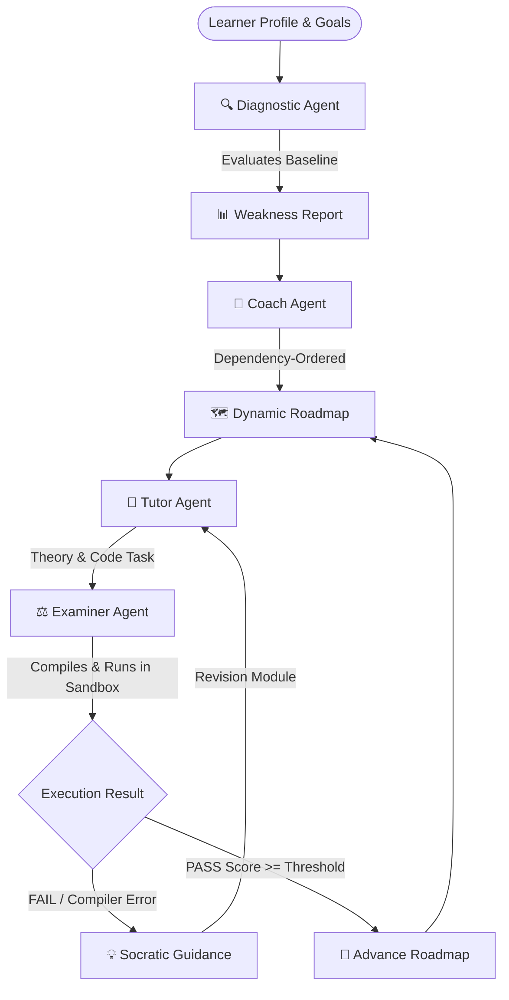

# 🤖 The 4 Specialized Autonomous Agents

## 1. Multi-Agent System Overview

Nereus replaces unstructured, free-form conversational loops with **four dedicated autonomous agents**. Each agent operates under strict functional boundaries, specialized system prompts, typed JSON output schemas, and domain invariants.



---

## 2. Agent 1: The Diagnostic Agent (`DiagnosticAgent`)

### Role & Objective
The Diagnostic Agent probes the learner's baseline competencies before any roadmap is assembled. Rather than asking vague self-assessment questions ("Are you a beginner or intermediate?"), it presents targeted technical micro-challenges and conceptual multiple-choice questions.

### Execution Workflow
1. **Trigger**: Invoked when starting a new session with `--diagnostic` or when `run_diagnostic: true` is configured.
2. **Question Generation**: Synthesizes 3–5 language-specific diagnostic questions covering:
   * Memory management & ownership/lifetimes.
   * Concurrency primitives & async scheduling.
   * Error handling paradigms & type invariants.
   * Idiomatic syntax & standard library usage.
3. **Answer Evaluation**: Evaluates learner selections and generates a structured `WeaknessReport`.

### Contract & Data Structures

```rust
use serde::{Deserialize, Serialize};

#[derive(Debug, Clone, Serialize, Deserialize)]
pub struct DiagnosticQuestion {
    pub id: String,
    pub question: String,
    pub options: Vec<String>,
    pub correct_index: Option<usize>,
}

#[derive(Debug, Clone, Default, Serialize, Deserialize)]
pub struct WeaknessReport {
    /// Categorical tags identifying verified skill gaps (e.g., ["Lifetimes", "Async Tokio"]).
    pub weak_areas: Vec<String>,
    /// High-priority topics recommended for immediate roadmap inclusion.
    pub recommended_topics: Vec<String>,
}
```

---

## 3. Agent 2: The Coach Agent (`CoachAgent`)

### Role & Objective
The Coach Agent serves as the strategic curriculum architect. It ingests the learner's goal, daily time commitment, target deadline, and the diagnostic `WeaknessReport`, then synthesizes a topologically sorted learning `Roadmap`.

### Planning Rules & Invariants
1. **Weak-Area Prioritization**: Topics addressing identified weak spots are scheduled early in the sequence, provided prerequisites are respected.
2. **Topological Dependency Order**: No topic is introduced before its prerequisites are mastered (e.g. "Ownership & Borrowing" must strictly precede "Arc & Mutex Concurrency").
3. **Time-Boxing**: Topics are partitioned into bite-sized units with estimated completion times matching the user's `hours_per_day` budget.

### Contract & Data Structures

```rust
#[derive(Debug, Clone, Serialize, Deserialize)]
pub struct RoadmapTopic {
    pub id: String,
    pub title: String,
    pub description: String,
    /// Normalized difficulty score between 0.0 (elementary) and 1.0 (advanced).
    pub difficulty: f32,
    /// List of topic IDs that must be completed before starting this topic.
    pub prerequisites: Vec<String>,
    pub estimated_hours: f32,
}

#[derive(Debug, Clone, Default, Serialize, Deserialize)]
pub struct Roadmap {
    pub topics: Vec<RoadmapTopic>,
}
```

---

## 4. Agent 3: The Tutor Agent (`TutorAgent`)

### Role & Objective
The Tutor Agent is responsible for instructional delivery and challenge authoring. When a topic is activated, the Tutor synthesizes concise conceptual theory followed by an interactive coding challenge.

### Instructional Tenets
1. **Bite-Sized Delivery**: Theory must be readable within 3–5 minutes (markdown with code snippets). Long, rambling textbooks are forbidden.
2. **Executable Challenge Specs**: Every task must define an explicit function signature, expected inputs, outputs, and edge cases suitable for automated compilation and unit testing.
3. **Dynamic Revision Authoring**: When the Examiner issues a `RETRY` verdict, the Tutor does **not** repeat the same lesson. Instead, it generates a targeted `Revision` focusing specifically on the compiler error or conceptual misunderstanding identified by the Examiner.

---

## 5. Agent 4: The Examiner Agent (`ExaminerAgent`)

### Role & Objective
The Examiner Agent is the uncompromising evaluator of student mastery. It executes student submissions inside the sandbox, inspects compiler warnings and test failures, calculates an objective mastery score, and generates Socratic guidance.

### Dynamic Pass Scoring Formula
Unlike simplistic static pass thresholds, Nereus dynamically scales the passing score based on topic difficulty:

$$\text{Threshold} = \min\left(70.0 + (\text{topic.difficulty} \times 15.0),\, 85.0\right)$$

* For an introductory topic ($\text{difficulty} = 0.2$): $\text{Threshold} = 70.0 + 3.0 = 73.0$
* For an intermediate topic ($\text{difficulty} = 0.6$): $\text{Threshold} = 70.0 + 9.0 = 79.0$
* For an advanced topic ($\text{difficulty} = 1.0$): $\text{Threshold} = \min(85.0, 85.0) = 85.0$

### Socratic Mentorship Principles (The "Lighthouse" Rule)

When an evaluation fails (`Verdict::Retry`), the Examiner must adhere strictly to the **Socratic Invariant**:

```text
 ┌────────────────────────────────────────────────────────────────────────┐
 │                      THE SOCRATIC INVARIANT                            │
 │                                                                        │
 │ 1. NEVER provide corrected code syntax or direct solutions.            │
 │ 2. Cite the exact compiler error (e.g., E0382) or failed assertion.   │
 │ 3. Ask one guided question leading the student to the root cause.      │
 │ 4. Provide one conceptual clue explaining the underlying invariant.    │
 └────────────────────────────────────────────────────────────────────────┘
```

#### Example Comparison: Sycophantic Bot vs Nereus Examiner

* **Sycophantic Chatbot Response** ❌:
  > *"Oops! You got compiler error E0382 because you used `tx` after moving it. Here is the corrected code: just clone it with `tx.clone()` before passing it into the thread!"*

* **Nereus Socratic Examiner Response** ✅:
  > **Verdict: RETRY (Score: 62.0/100, Passing Threshold: 79.0)**  
  > **Compiler Diagnostic**: `error[E0382]: use of moved value: tx`  
  > **Socratic Reflection**:  
  > *"Notice line 14: when you pass `tx` into `tokio::spawn`, the channel sender ownership is transferred into that closure's stack frame. What does the `mpsc` acronym stand for, and what capability does cloning the sender provide when multiple tasks need to produce messages?"*

### Contract & Data Structures

```rust
#[derive(Debug, Clone, PartialEq, Eq, Serialize, Deserialize)]
#[serde(rename_all = "lowercase")]
pub enum Verdict {
    Pass,
    Retry,
}

#[derive(Debug, Clone, Serialize, Deserialize)]
pub struct Assessment {
    pub topic_id: String,
    pub score: f32,
    pub verdict: Verdict,
    pub feedback: String,
    pub weak_areas: Vec<String>,
}
```

---

## 6. Structured Inference & Retry Protocol

All agent-to-LLM communications use strongly typed JSON schemas with automatic recovery:

```mermaid
sequenceDiagram
    autonumber
    participant Agent as Agent Execution
    participant Client as StructuredInferenceClient
    participant LLM as LLM Provider

    Agent->>Client: request_structured::<T>(prompt, schema)
    Client->>LLM: Complete with JSON instruction
    LLM-->>Client: Raw JSON String

    alt Valid JSON conforming to Schema T
        Client-->>Agent: Ok(T)
    else Parse / Schema Mismatch Error
        Client->>LLM: Retry with Error Diagnostic + Correction Prompt
        LLM-->>Client: Corrected Raw JSON String
        alt Success on Retry
            Client-->>Agent: Ok(T)
        else Second Failure
            Client-->>Agent: Err(LLMError::SerializationError)
        end
    end
```



---

<div align="center">
  <sub>Nereus Labs Agent System Specification • v2.0 • MIT License</sub>
</div>
