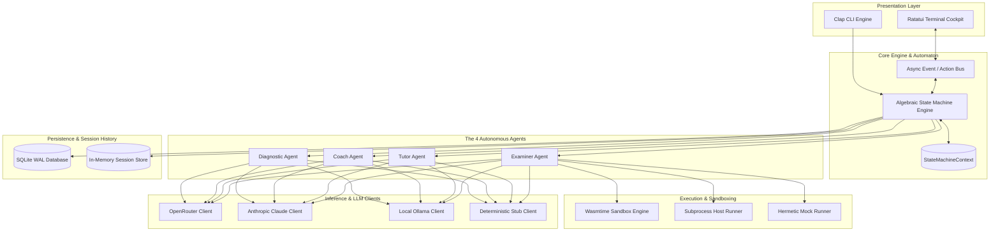
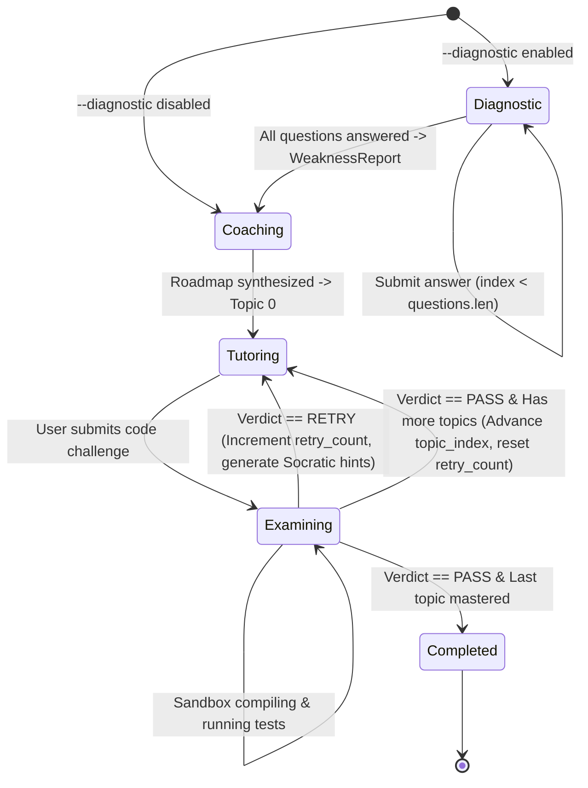
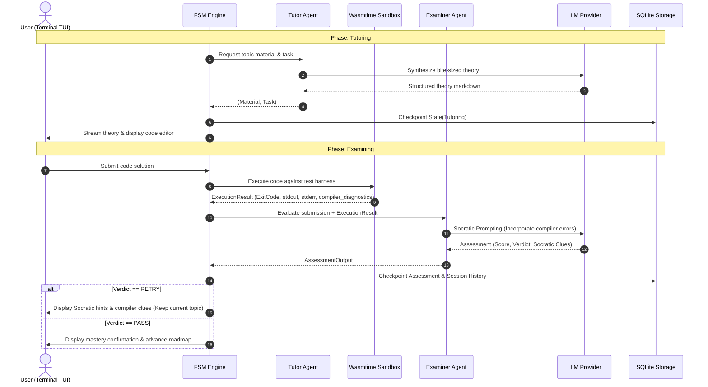

# 🏛️ Nereus 2.0 System Architecture

## 1. System Philosophy & Objectives

**Nereus 2.0** is an interactive, terminal-native AI coding cockpit and autonomous programming mentor engineered from the ground up in **idiomatic Rust**.

The primary mission of Nereus is to transform programming education by replacing flattering, solution-leaking chatbots with an uncompromising, execution-driven learning experience. The system is governed by four core architectural tenets:

1. **Compile-Time State Verification**:
   All states and valid transitions are modeled using Rust's algebraic type system (`enum LearningState`). Invalid states cannot be compiled or represented at runtime.
2. **Sub-millisecond Latency & Zero Runtime Dependencies**:
   A single, self-contained native binary with instant startup (<5ms) and negligible memory consumption (~12MB RAM), allowing seamless operation inside developer terminals, remote SSH sessions, and constrained environments.
3. **Execution-Driven Assessment**:
   Student code is compiled and tested inside an isolated sandbox (WebAssembly / container / process jail). The evaluation agent inspects actual compiler diagnostics, AST invariants, and runtime assertions rather than guessing based on textual LLM intuition.
4. **Hermetic Testability & Offline-First Discipline**:
   100% of the state automaton, agent logic, UI rendering, and test suites run completely offline without external network dependencies or API token costs via deterministic mock clients (`StubLLMClient`, `MockSandbox`).

---

## 2. Architectural Evolution: From Python v1 to Rust v2

Nereus v1 proved the pedagogical model (4 autonomous agents, Socratic loops, dynamic pass scoring, adaptive diagnostics). However, real-world deployment exposed severe structural bottlenecks inherent in Python-based AI frameworks.

### Comparison Matrix

```text
┌────────────────────────┬───────────────────────────────────┬──────────────────────────────────┐
│ Dimension              │ Nereus 1.x (Python / LangGraph)   │ Nereus 2.0 (Rust / Algebraic FSM) │
├────────────────────────┼───────────────────────────────────┼──────────────────────────────────┤
│ Runtime Engine         │ LangGraph StateGraph              │ Custom Algebraic Event Automaton │
│ State Representation   │ TypedDict dictionary with pickling│ Strongly typed Rust Enum variant │
│ Human-in-the-Loop      │ langgraph.types.interrupt()       │ Tokio mpsc channels & async wait │
│ Cold Startup Time      │ ~2,500ms – 4,000ms                │ < 5ms                            │
│ Baseline Memory (RSS)  │ ~250MB – 450MB (Torch/ChromaDB)   │ ~12MB – 18MB                     │
│ Code Evaluation        │ Textual LLM Prompt Inspection     │ Sandboxed Compilation & Testing  │
│ Distribution           │ Virtualenvs, pip, heavy wheels    │ Single static executable binary  │
│ Interface              │ Web UI (Chainlit)                 │ Terminal Cockpit (Ratatui TUI)   │
│ Concurrency Model      │ Python GIL / asyncio              │ Tokio multi-threaded work-stealing│
└────────────────────────┴───────────────────────────────────┴──────────────────────────────────┘
```

### Why LangGraph Was Replaced

1. **Opaque Graph Serialization & State Drift**:
   LangGraph serializes the entire state dictionary via checkpointers. Type evolution between releases frequently led to deserialization crashes or silently dropped state keys. In Rust, all state transitions consume and produce strongly typed data structures verified by `serde`.
2. **Interrupt Fragility**:
   Python `interrupt()` calls pause graph execution by raising internal exceptions that unwind the stack. Resuming required passing arbitrary objects (`dict` vs JSON `str`), necessitating defensive JSON guards throughout nodes.
3. **Bloated Runtime Footprint**:
   Dependencies like `pydantic`, `langgraph`, `chromadb`, and `torch` introduced hundreds of megabytes of disk overhead and multi-second import latencies, conflicting with the goal of a nimble CLI tool.

---

## 3. High-Level Subsystem Topology

Nereus 2.0 comprises six primary decoupled subsystems coordinated through an asynchronous event bus:



---

## 4. The Algebraic Finite State Machine (FSM)

At the heart of Nereus 2.0 is an explicit, exhaustive algebraic state machine. State is represented as an enum where each variant owns the exact payload required for that lifecycle stage:

```rust
use serde::{Deserialize, Serialize};
use uuid::Uuid;
use crate::models::*;

/// Exhaustive state variants representing the entire learner lifecycle.
#[derive(Debug, Clone, Serialize, Deserialize, PartialEq)]
pub enum LearningState {
    /// 1. Diagnostic phase: probing the student's baseline knowledge.
    Diagnostic {
        questions: Vec<DiagnosticQuestion>,
        current_index: usize,
        answers: Vec<String>,
    },
    /// 2. Coaching phase: generating or revising the prioritized roadmap.
    Coaching {
        weakness_report: WeaknessReport,
    },
    /// 3. Tutoring phase: delivering theory and hands-on coding task.
    Tutoring {
        topic: RoadmapTopic,
        material: String,
        task: String,
        retry_count: usize,
    },
    /// 4. Examining phase: executing submission in sandbox & generating assessment.
    Examining {
        topic: RoadmapTopic,
        task: String,
        submission: Option<String>,
        assessment: Option<Assessment>,
    },
    /// 5. Completed phase: all topics mastered to criteria.
    Completed,
}

/// The overarching session context maintaining immutable identity and current state.
pub struct StateMachineContext {
    pub session_id: Uuid,
    pub profile: UserProfile,
    pub roadmap: Roadmap,
    pub current_topic_index: usize,
    pub state: LearningState,
}
```

### State Transition Lifecycle



### Transition Guarantees

1. **Deterministic Next Steps**: Given `StateMachineContext` and an incoming `UserAction`, the state transition function is pure and deterministic:
   $$\text{transition}(S_t, A) \rightarrow S_{t+1}$$
2. **Retry Guard & Max Attempts**: If a student exhausts the maximum permitted attempts (`max_retries`, default 3) on a single topic, the state machine triggers a pedagogical recovery branch: either an auxiliary foundational topic is dynamically spliced into the roadmap, or an instructor bypass pass is recorded with marked weak spots.
3. **Session Rehydration**: Because `LearningState` implements `Serialize` and `Deserialize`, the entire automaton context can be saved to SQLite on any state boundary and reloaded with zero loss of execution state.

---

## 5. Subsystem Data Flow & Boundaries

### The Learning Loop Step-by-Step



---

## 6. Threading, Concurrency & Error Model

### Tokio Runtime Model
* **Multi-threaded Worker Pool**: Nereus initializes Tokio with `rt-multi-thread`. UI rendering runs on the primary thread to honor terminal raw-mode constraints, while LLM networking and sandbox executions are offloaded to asynchronous background worker tasks.
* **Channel Communication**: The TUI and FSM communicate via bounded Tokio `mpsc` channels (`mpsc::Sender<AppEvent>`, `mpsc::Receiver<UiAction>`), preventing race conditions and rendering stutter.

### Error Handling Philosophy
Nereus strictly separates recoverable domain errors from unrecoverable system failures using `thiserror` and `anyhow`:

```rust
use thiserror::Error;

#[derive(Error, Debug)]
pub enum NereusError {
    #[error("LLM Provider error: {0}")]
    Llm(#[from] crate::llm::LLMError),

    #[error("Sandbox execution timeout after {0} seconds")]
    SandboxTimeout(u64),

    #[error("Sandbox compilation failed: {0}")]
    SandboxCompilation(String),

    #[error("Storage engine error: {0}")]
    Storage(String),

    #[error("Invalid state transition from {from:?} via {action}")]
    InvalidTransition { from: String, action: String },
}
```

---

## 7. Security & Sandboxing Model

Allowing an AI mentor to compile and run arbitrary user or generated code introduces significant security hazards. Nereus guarantees system safety through a layered defense model:

1. **Primary Defense: WebAssembly Sandbox (`wasmtime`)**:
   * Code is compiled to WebAssembly (WASM) and executed inside an isolated Wasmtime instance.
   * **Capability-based security**: Zero access to the host filesystem, environment variables, or network sockets.
   * **Fuel Metering**: CPU execution steps are bounded by fuel consumption limits to prevent infinite loops.
   * **Memory Caps**: WebAssembly linear memory is capped (default: 64MB).
2. **Secondary Defense: Host Subprocess Isolation**:
   * For non-WASM languages (e.g. native C/Rust/Python), executions use Linux namespaces/cgroups, macOS `sandbox-exec`, or Windows Job Objects with strict execution timeouts (default: 5.0s).
3. **Hermetic Test Isolation**:
   * Test suites bypass host execution entirely, utilizing the `MockSandboxRunner` with predefined deterministic outputs.

---

## 8. Architectural Decision Records (ADRs)

Key architectural decisions are formally documented and tracked in [`docs/adr/`](adr/README.md) using the MADR standard:

* [ADR 0001: Record Architecture Decisions](adr/0001-record-architecture-decisions.md)
* [ADR 0002: Compile-Time Algebraic State Machine over LangGraph](adr/0002-compile-time-algebraic-state-machine-over-langgraph.md)
* [ADR 0003: Wasmtime & Host Compiler Dual Execution Sandbox](adr/0003-wasmtime-and-host-compiler-dual-sandbox.md)
* [ADR 0004: Offline-First Zero-Token Testing Discipline](adr/0004-offline-first-zero-token-testing-discipline.md)
* [ADR 0005: Ratatui Split-Pane Terminal Cockpit over Web UI](adr/0005-ratatui-split-pane-terminal-cockpit.md)
* [ADR 0006: Multi-Channel Native Distribution](adr/0006-multi-channel-native-distribution.md)

---

<div align="center">
  <sub>Nereus Labs Architecture Specification • v2.0 • MIT License</sub>
</div>
