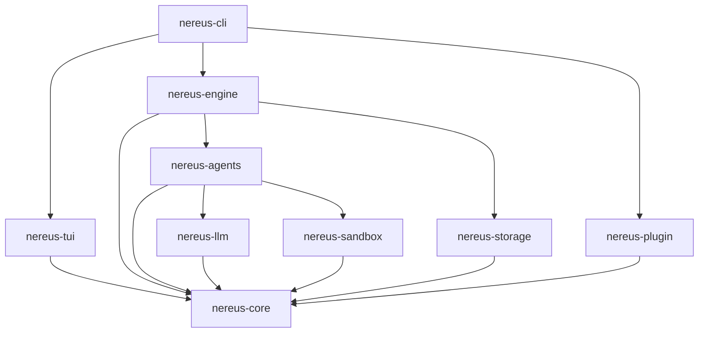

# 🧩 Nereus Modular Framework & Hot-Switching Architecture

## 1. Overview & Architectural Motivation

To scale Nereus from a single-binary prototype into an extensible, enterprise-grade AI mentorship platform, the codebase adopts a **modular crate framework**.

This modular architecture addresses three fundamental engineering objectives:

1. **Worktree-Per-Module Development**:
   Engineers and autonomous agents can work on distinct subsystems (e.g. `nereus-sandbox`, `nereus-agents`, `nereus-tui`) inside completely isolated Git Worktrees (`git worktree`) without stepping on each other's commits or triggering workspace-wide rebuilds.
2. **Strict Inversion of Control & Loose Coupling**:
   Core domain types and state transitions depend exclusively on abstract traits, not concrete implementations.
3. **Hot-Switching & Dynamic Module Swapping**:
   Subsystems such as LLM inference backends, evaluation sandboxes, agent personalities, and storage engines can be swapped at runtime or configuration-time without dropping active session state.

---

## 2. Cargo Workspace Architecture

The system is decomposed into a clean Cargo workspace containing 9 specialized crates:

```text
nereus/ (Cargo Workspace Root)
├── Cargo.toml                      # Workspace definition & shared dependency versions
├── crates/
│   ├── nereus-core/                # Domain models, core traits, FSM state definitions
│   ├── nereus-engine/              # FSM runtime, transition engine, event loop
│   ├── nereus-agents/              # The 4 specialized agents (Diagnostic, Coach, Tutor, Examiner)
│   ├── nereus-llm/                 # Multi-provider LLM clients (Stub, OpenRouter, Claude, Ollama)
│   ├── nereus-sandbox/             # Execution sandboxes (Wasmtime WASM, host subprocess, mock)
│   ├── nereus-storage/             # Persistence engine (SQLite WAL, in-memory, session migration)
│   ├── nereus-tui/                 # Ratatui terminal cockpit, split panes, theme engine
│   ├── nereus-plugin/              # Dynamic plugin host, ABI verification, WASM/dylib loader
│   └── nereus-cli/                 # Main executable entry point, Clap CLI parsing, telemetry
└── docs/                           # Architecture, specifications, and guides
```

### Dependency Invariants

The crate dependency hierarchy is strictly unidirectional:



### Crate Catalog & Boundaries

| Crate | Responsibility | Primary Dependencies |
| :--- | :--- | :--- |
| **`nereus-core`** | Fundamental domain types (`UserProfile`, `Roadmap`, `Assessment`), algebraic FSM enum (`LearningState`), core traits (`Agent`, `LLMClient`, `SandboxRunner`, `SessionStore`), and error definitions. | `serde`, `serde_json`, `uuid`, `chrono`, `thiserror`, `async-trait` |
| **`nereus-engine`** | Orchestrates state transitions, drives the event loop, enforces retry caps, and dispatches UI actions. | `nereus-core`, `tokio`, `tracing` |
| **`nereus-agents`** | Concrete implementations of `DiagnosticAgent`, `CoachAgent`, `TutorAgent`, and `ExaminerAgent`. Embeds Socratic guidance logic and prompt templates. | `nereus-core`, `nereus-llm`, `nereus-sandbox`, `tracing` |
| **`nereus-llm`** | Asynchronous HTTP and streaming clients for OpenRouter, Anthropic Claude, Ollama, and the deterministic `StubLLMClient`. | `nereus-core`, `reqwest`, `eventsource-stream`, `tokio` |
| **`nereus-sandbox`** | Code compilation, sandboxed runtime verification via WebAssembly (`wasmtime`), OS subprocess isolation, and execution output parsing. | `nereus-core`, `wasmtime`, `tokio`, `tracing` |
| **`nereus-storage`** | Session state serialization, SQLite persistence with WAL mode, historical assessments, and progress metrics. | `nereus-core`, `rusqlite`, `tokio`, `tracing` |
| **`nereus-tui`** | Terminal User Interface built with Ratatui and Crossterm. Renders split panes for roadmap tracking, theory reading, code editing, and Socratic feedback. | `nereus-core`, `ratatui`, `crossterm`, `tokio` |
| **`nereus-plugin`** | Dynamic loading and hot-swapping runtime supporting both shared library (`.dylib`/`.so`) and WebAssembly Component plugins. | `nereus-core`, `wasmtime`, `libloading`, `notify` |
| **`nereus-cli`** | The top-level binary entry point. Parses CLI flags, configures logging/tracing, wires dependency injection, and launches the cockpit. | All crates, `clap`, `anyhow` |

---

## 3. Worktree-Per-Module Development Strategy

### Why Git Worktrees?
Traditional monorepos often suffer from merge conflicts and context thrashing when multiple developers or autonomous coding agents work on the same working tree simultaneously. Git Worktrees allow checking out multiple branches of the same repository into completely separate local directories:

```text
/Users/yan/Pets/
├── Nereus/                         # Primary repository (main / develop branch)
└── worktrees/                      # Isolated module development workspaces
    ├── nereus-agents-socratic/     # Branch: feat/agents-socratic-v2
    ├── nereus-sandbox-wasm/        # Branch: feat/sandbox-wasmtime
    ├── nereus-tui-cockpit/         # Branch: feat/tui-ratatui-cockpit
    └── nereus-storage-sqlite/      # Branch: feat/storage-rusqlite
```

### Worktree Workflow Step-by-Step

#### 1. Creating a New Module Worktree
```bash
# Navigate to the primary repository
cd /Users/yan/Pets/Nereus

# Create an isolated worktree for sandbox development
git worktree add ../worktrees/nereus-sandbox-wasm -b feat/sandbox-wasmtime develop
```

#### 2. Working Inside the Module Worktree
```bash
cd ../worktrees/nereus-sandbox-wasm

# Make changes strictly isolated to crates/nereus-sandbox/
# Run tests specifically for this crate:
cargo test -p nereus-sandbox

# Format and lint only this crate:
cargo clippy -p nereus-sandbox -- -D warnings
```

#### 3. Committing and Opening Pull Request
```bash
git add crates/nereus-sandbox/
git commit -m "feat(sandbox): implement Wasmtime fuel metering and memory caps"
git push -u origin feat/sandbox-wasmtime
gh pr create --base develop --title "feat(sandbox): implement Wasmtime fuel metering"
```

#### 4. Cleaning Up the Worktree
Once the PR is merged into `develop`:
```bash
cd /Users/yan/Pets/Nereus
git worktree remove ../worktrees/nereus-sandbox-wasm
git branch -d feat/sandbox-wasmtime
```

---

## 4. Multi-Tier Hot-Switching Architecture

Nereus supports three tiers of hot-switching, ranging from lightweight runtime dispatch to dynamic WebAssembly component reloads:

```mermaid
flowchart TD
    subgraph Tier1 [Tier 1: Dynamic In-Memory Dispatch]
        T1_Reg[ModuleRegistry]
        T1_Trait[Arc dyn LLMClient / SandboxRunner]
        T1_Config[Config / TUI Selection]
        T1_Config -->|Instant switch <1ms| T1_Reg --> T1_Trait
    end

    subgraph Tier2 [Tier 2: Shared Library Hot-Reload]
        T2_Watcher[FS Watcher: notify]
        T2_Loader[libloading Engine]
        T2_ABI[Stable C-ABI / FFI Gate]
        T2_Watcher -->|Recompiled .so/.dylib| T2_Loader --> T2_ABI
    end

    subgraph Tier3 [Tier 3: WASM Component Model]
        T3_Host[Wasmtime Component Host]
        T3_Plugin[WASM Agent Plugin .wasm]
        T3_State[State Transfer Protocol]
        T3_Host -->|Hot-Swap in <5ms| T3_Plugin --> T3_State
    end
```



### Tier 1: In-Memory Dynamic Trait Dispatch (`ModuleRegistry`)

The simplest and most resilient hot-switching mechanism operates entirely in-memory using atomic references (`Arc<RwLock<...>>`).

```rust
use std::sync::Arc;
use tokio::sync::RwLock;
use nereus_core::traits::{LLMClient, SandboxRunner};

/// Dynamic module registry allowing runtime swapping of active backends.
#[derive(Clone)]
pub struct ModuleRegistry {
    llm_client: Arc<RwLock<Arc<dyn LLMClient>>>,
    sandbox_runner: Arc<RwLock<Arc<dyn SandboxRunner>>>,
}

impl ModuleRegistry {
    pub fn new(llm: Arc<dyn LLMClient>, sandbox: Arc<dyn SandboxRunner>) -> Self {
        Self {
            llm_client: Arc::new(RwLock::new(llm)),
            sandbox_runner: Arc::new(RwLock::new(sandbox)),
        }
    }

    /// Hot-switch the active LLM client without restarting the engine.
    pub async fn switch_llm(&self, new_client: Arc<dyn LLMClient>) {
        let mut guard = self.llm_client.write().await;
        *guard = new_client;
        tracing::info!("Hot-switched LLM client successfully");
    }

    /// Retrieve the currently active LLM client for an agent turn.
    pub async fn get_llm(&self) -> Arc<dyn LLMClient> {
        self.llm_client.read().await.clone()
    }
}
```

* **Use Case**: Switching from offline `StubLLMClient` to live `AnthropicClient` when an API key is entered in the TUI, or switching from WASM sandbox to local host runner when native C compilation is needed.
* **Latency**: $< 1\mu s$ (instantaneous memory pointer swap).

---

### Tier 2: Shared Library (`.dylib`/`.so`) Hot-Reloading

For native agent plugins compiled as shared objects, `nereus-plugin` uses `libloading` with strict ABI checking:

```rust
use libloading::{Library, Symbol};
use std::path::Path;
use nereus_core::traits::Agent;

pub struct NativePluginHost {
    loaded_library: Option<Library>,
    active_agent: Option<Box<dyn Agent>>,
}

impl NativePluginHost {
    pub unsafe fn load_plugin<P: AsRef<Path>>(&mut self, path: P) -> anyhow::Result<()> {
        let lib = Library::new(path.as_ref())?;
        
        // Check ABI version compatibility
        let get_abi_version: Symbol<extern "C" fn() -> u32> = lib.get(b"nereus_plugin_abi_version")?;
        let version = get_abi_version();
        anyhow::ensure!(version == nereus_core::PLUGIN_ABI_VERSION, "Incompatible plugin ABI version");

        // Instantiate plugin factory
        let create_agent: Symbol<extern "C" fn() -> *mut dyn Agent> = lib.get(b"nereus_create_agent")?;
        let raw_agent = create_agent();
        
        self.active_agent = Some(Box::from_raw(raw_agent));
        self.loaded_library = Some(lib);
        tracing::info!("Native plugin loaded from {:?}", path.as_ref());
        Ok(())
    }
}
```

---

### Tier 3: WebAssembly (WASM) Component Model Hot-Swapping

The most secure and flexible hot-swapping tier runs plugins as WebAssembly components on `wasmtime`.

* **Memory Safety**: WASM plugins execute in sandboxed linear memory; an invalid pointer access or panic inside a plugin cannot crash the primary Nereus process.
* **Hot-Swap Protocol**:
  1. Engine receives `PluginReloadEvent(plugin_id)`.
  2. Active agent state is serialized into `serde_json::Value`.
  3. Previous WASM component instance is terminated and deallocated.
  4. New `.wasm` component binary is instantiated in Wasmtime.
  5. Serialized state is piped back into the newly loaded component.
  6. Learning loop resumes with $< 5\text{ms}$ interruption.

---

## 5. Module Lifecycle Management

Every pluggable module adheres to the standard `ModuleLifecycle` contract:

```rust
use async_trait::async_trait;
use serde_json::Value;

#[async_trait]
pub trait ModuleLifecycle: Send + Sync {
    /// Initialized when the module is registered.
    async fn on_initialize(&mut self) -> Result<(), crate::NereusError>;

    /// Invoked immediately before the module is hot-unloaded.
    /// Returns any internal state that should be transferred to the replacement module.
    async fn on_export_state(&self) -> Result<Option<Value>, crate::NereusError> {
        Ok(None)
    }

    /// Invoked after hot-loading to rehydrate exported state.
    async fn on_import_state(&mut self, _state: Value) -> Result<(), crate::NereusError> {
        Ok(())
    }

    /// Final cleanup before termination.
    async fn on_terminate(&mut self) -> Result<(), crate::NereusError>;
}
```

---

<div align="center">
  <sub>Nereus Labs Modular Framework Specification • v2.0 • MIT License</sub>
</div>
