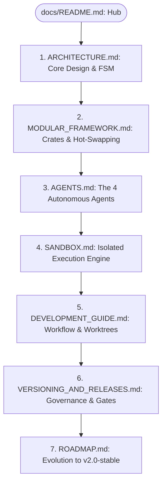

# 🌊 Nereus Documentation Hub

Welcome to the comprehensive technical documentation for **Nereus** — the terminal-native, autonomous AI programming mentor and execution-driven learning cockpit developed by **Nereus Labs**.

---

## 🎯 Executive Overview

Nereus replaces unstructured, sycophantic chatbot interactions with an **honest, adaptive, and execution-driven learning lifecycle**. Instead of providing unearned answers, Nereus employs a strict Socratic teaching methodology, verifies code submissions in isolated compilation and execution sandboxes, and orchestrates learner progression via a mathematically sound **Algebraic Finite State Machine (FSM)**.

### Architectural Epochs

| Dimension | Nereus 1.x (Archived / Legacy) | Nereus 2.0 (Active Production Target) |
| :--- | :--- | :--- |
| **Language & Runtime** | Python 3.11+, LangGraph, Pydantic, Chainlit | **Idiomatic Rust (2021 Edition)**, Tokio async runtime |
| **Automaton Engine** | Dynamic dictionary graph (`TypedDict` + interrupts) | **Algebraic FSM (`enum LearningState`)** with exhaustive matching |
| **Startup & Latency** | Cold start > 2.5s, RAM ~250MB (ChromaDB + PyTorch) | **Cold start < 5ms, RAM ~12MB**, zero runtime dependencies |
| **User Interface** | Web UI (Chainlit) disconnected from developer tools | **Terminal Cockpit (Ratatui TUI)** with split streaming panes |
| **Code Assessment** | Prompt-based textual inspection (hallucination prone) | **Isolated Sandbox Execution** (Wasmtime WASM & compiler feeds) |
| **Testing Paradigm** | Hermetic `StubLLMProvider` + Pytest autouse guards | Hermetic `StubLLMClient` trait mock + compile-time invariants |
| **License** | MIT (archived at `nereuslabs/nereus-v1`) | **MIT** (`nereuslabs/nereus`) |

---

## 📚 Documentation Map & Recommended Reading Order

This documentation suite is designed for human software engineers, system architects, and autonomous coding agents. Follow the reading order below based on your role:

### 1. [System Architecture (`ARCHITECTURE.md`)](ARCHITECTURE.md)
* Deep dive into the system philosophy and design invariants.
* Migration rationale: moving from LangGraph's dynamic state pickling to Rust's type-verified algebraic state machine.
* Subsystem topology, lifecycle guarantees, and full Mermaid architectural diagrams.

### 2. [Modular Framework & Hot-Swapping (`MODULAR_FRAMEWORK.md`)](MODULAR_FRAMEWORK.md)
* The Cargo Workspace decomposition into 9 independent crates.
* The **Worktree-Per-Module** engineering strategy (`git worktree`) for isolated, non-blocking feature development.
* Multi-tier **Hot-Switching Architecture**:
  * Level 1: In-memory dynamic trait dispatch (`ModuleRegistry`).
  * Level 2: Shared library (`.dylib`/`.so`) hot-reloading with stable C-ABI boundaries.
  * Level 3: WebAssembly (WASM) Component Model plugin host on `wasmtime`.

### 3. [The 4 Autonomous Agents (`AGENTS.md`)](AGENTS.md)
* Comprehensive breakdown of the 4 specialized agent roles:
  * 🔍 **Diagnostic Agent**: Baseline skill probing, question taxonomy, and `WeaknessReport` generation.
  * 🧭 **Coach Agent**: Milestone planning and dependency-ordered, weak-area-prioritized `Roadmap`.
  * 📖 **Tutor Agent**: Theory synthesis, interactive coding challenges, and dynamic revision generation.
  * ⚖️ **Examiner Agent**: Execution-driven assessment, dynamic pass threshold formula, and Socratic feedback rules.
* Prompt contracts, JSON schemas, and structured inference retry strategies.

### 4. [Execution Sandbox Engine (`SANDBOX.md`)](SANDBOX.md)
* Why execution-driven assessment supersedes textual LLM evaluation.
* The in-memory WebAssembly sandbox powered by `wasmtime` (resource limits, fuel metering, zero host leaks).
* Subprocess runner with OS-level sandboxing (bubblewrap / chroot / job objects).
* Deterministic offline mock runner for hermetic test suites.

### 5. [Development & Engineering Guide (`DEVELOPMENT_GUIDE.md`)](DEVELOPMENT_GUIDE.md)
* Local environment setup, Rust toolchain requirements, and recommended developer tools.
* Quality standards: Conventional Commits, `cargo fmt`, `cargo clippy -- -D warnings`.
* Offline-first testing discipline with `StubLLMClient` (zero API tokens consumed during CI).
* Detailed instructions for managing Git Worktrees across modules.

### 6. [Versioning, Governance & Releases (`VERSIONING_AND_RELEASES.md`)](VERSIONING_AND_RELEASES.md)
* Strict Semantic Versioning (SemVer 2.0).
* Branching policy: `develop` as the integration fast lane vs `main` as the protected release gate.
* GitHub Repository Ruleset policy (`id=20506063`), required status checks, and admin-bypass rules.
* Release verification checklist and SHA validation protocol (`git rev-list -n1 vX.Y.Z == main`).

### 7. [Roadmap to v2.0-Stable (`ROADMAP.md`)](ROADMAP.md)
* Chronological development phases from Phase 0 (Domain Model) to Phase 8 (v2.0-stable).
* Deliverables, success metrics, and issue references for each milestone.

---

## 🏛️ System Invariants & Guarantees

Every module, agent, and contribution to Nereus must satisfy three non-negotiable invariants:

1. **Deterministic Testability (Offline-First)**:
   The complete learning cycle, state transitions, TUI rendering, and test suites must run 100% hermetically without requiring an API key, an active network connection, or external cloud infrastructure. The `StubLLMClient` and mock sandbox provide bit-for-bit reproducible outcomes.
2. **Invalid States are Unrepresentable**:
   State transitions are enforced at compile time using Rust enums. An agent cannot trigger an examination before tutoring material is prepared; a roadmap cannot advance on a `RETRY` verdict without an explicit bypass override.
3. **Strict Socratic Mentorship**:
   The system never dumps full solutions to students when they encounter compiler or test failures. The Examiner identifies the failing invariant, presents the exact compiler diagnosis, and asks a guided question that leads the learner to discover the root cause independently.

---

  Nereus Labs • Built with precision in Rust • Licensed under MIT

