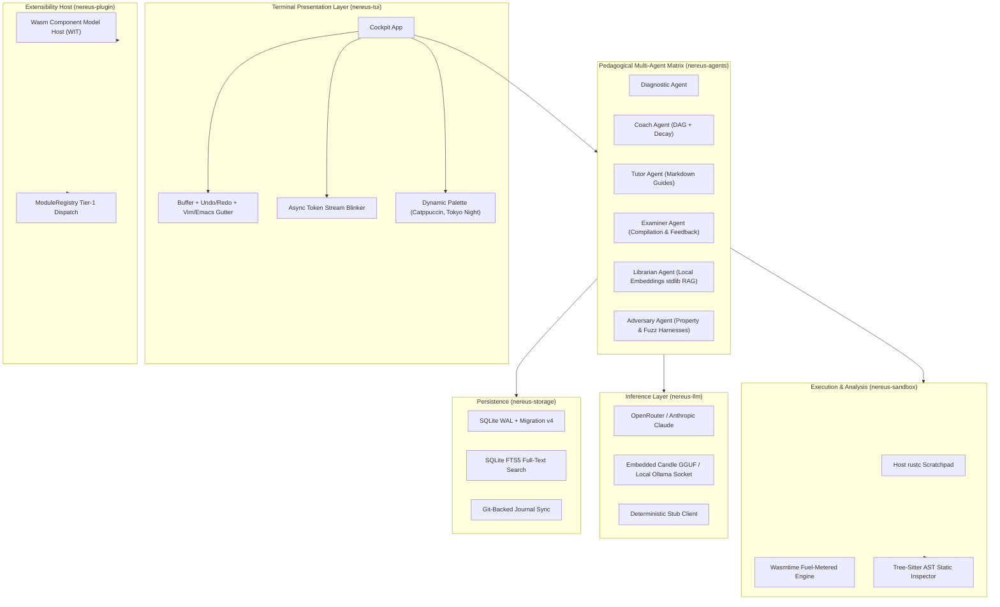

# RFC: Nereus v0.3.0 (Phase 2) — Advanced Architecture, Local Inference & TUI Evolution

* **RFC Number**: 0003
* **Status**: Proposed / Accepted for Phase 2 Implementation
* **Author**: Nereus Engineering Team
* **Target Version**: `v0.3.0` (Milestone Phase 2)
* **Date**: 2026-11-14

---

## 1. Executive Summary & Vision

Following the successful release of the **Nereus 2.0 MVP (v0.2.0)**, Nereus has established a robust 9-crate modular foundation with compile-time algebraic state guarantees, Ratatui split-pane cockpit, hermetic offline testing, and multi-channel native distribution.

**Nereus v0.3.0** focuses on transforming Nereus from a single-track terminal mentor into an **autonomous, privacy-first, extensible pedagogical operating environment**. Key vectors of improvement include:
1. **Zero-Token Local Intelligence**: In-process GGUF model execution (`candle`) and native `Ollama` socket integration.
2. **Semantic AST Code Analysis**: Real-time static inspection using `tree-sitter-rust` before compilation to guide learners away from antipatterns.
3. **Wasm Component Model Plugins**: Dynamic loading of sandboxed third-party curricula and custom agents via WebAssembly Interface Types (WIT).
4. **Professional TUI Cockpit Polish**: Undo/redo rings, line gutters, search/replace, Vim/Emacs keybindings, mouse support, and theme customization.
5. **Multi-Agent Expansion**: Introducing the `LibrarianAgent` (offline documentation RAG) and `AdversaryAgent` (property-based edge-case fuzzing).

---

## 2. Architectural Innovations



### 2.1. In-Process Local LLM Inference (`nereus-llm`)
- **Problem**: Cloud LLMs require paid API keys and network connectivity. The deterministic `StubLLMClient` is ideal for CI but lacks adaptive natural language explanations for human users traveling or working offline.
- **Solution**:
  - Embedded small language models (e.g., Qwen 2.5 Coder 1.5B/3B, SmolLM2) executed via Hugging Face's pure Rust `candle` framework with quantized GGUF weights.
  - Native Unix domain socket and HTTP bridge to existing local `Ollama` installations (`http://localhost:11434`), eliminating API key requirements.
  - Automatic hardware acceleration detection (Metal on Apple Silicon macOS, Vulkan/CUDA on Linux/Windows).

### 2.2. AST-Based Static Semantic Inspection (`nereus-sandbox`)
- **Problem**: `HostSandboxRunner` relies on compiler error diagnostics (`rustc --json`). The compiler flags syntax and type failures, but cannot evaluate pedagogical code smells (e.g., redundant `.clone()`, improper `unsafe`, unidiomatic loops where iterators are preferred, or panic-prone `.unwrap()` in production exercises).
- **Solution**:
  - Integrate `tree-sitter` and `tree-sitter-rust` into `nereus-sandbox::ast`.
  - Parse candidate solutions into a concrete syntax tree (CST).
  - Execute pedagogical query rules against AST patterns before invoking `rustc`.
  - Provide proactive Socratic questioning (e.g., *"Notice line 14: You called `.clone()` on a `String`. Can you achieve this with a borrowed slice `&str` instead?"*).

### 2.3. WebAssembly Component Model & WIT Plugins (`nereus-plugin`)
- **Problem**: Monolithic curricula bundled into the binary cannot be extended by external universities, bootcamps, or organizations without rebuilding the Rust workspace.
- **Solution**:
  - Implement Tier-3 hot-swapping using the Wasmtime Component Model (`wasmtime::component`).
  - Define standard WebAssembly Interface Types (WIT):
    ```wit
    package nereus:curriculum@0.3.0;

    interface topic-provider {
        record challenge {
            id: string,
            title: string,
            difficulty: u32,
            starter-code: string,
            test-harness: string,
            concept-tags: list<string>,
        }

        get-manifest: func() -> list<challenge>;
        evaluate-solution: func(code: string) -> result<string, string>;
    }
    ```
  - Educators compile custom curricula into `.wasm` components and drop them into `~/.nereus/plugins/`.

---

## 3. TUI / UX Cockpit Polish & Editor Upgrades

### 3.1. Editor Buffer Evolution
- **Undo / Redo Ring**: Bi-directional historical ring tracking mutations (`Ctrl+Z`, `Ctrl+Y`).
- **Syntax Gutter & Line Numbers**: Left-aligned dynamic line numbering with compiler error marker indicators (`►`, `✗`).
- **Auto-Indentation**: Automatic indentation preservation when pressing `Enter` following open braces `{` or brackets `[`.
- **Search & Replace**: In-buffer modal (`Ctrl+F`) with substring highlighting and `Next` / `Prev` navigation.
- **Vim / Emacs Keybinding Profiles**: Toggleable modal keymap supporting `h/j/k/l`, `w/b`, `dd`, `yy`, `p`, `:w`, and `:q`.
- **Mouse Event Support**: Full crossterm mouse capture allowing mousewheel scrolling across panes, clicking to switch focus, and dragging pane separators.

### 3.2. Real-Time Streaming Output
- Render LLM responses token-by-token directly into the `Ratatui` buffer via asynchronous channel polling (`tokio::sync::mpsc`).
- Animated blinking cursor with dynamic speed modulation matching natural typing cadence.

### 3.3. Theme Engine
Configurable theme palette with dynamic live hot-reloading:
- **Catppuccin Mocha** (Modern vibrant pastel dark mode)
- **Tokyo Night** (Classic neon cyberpunk blue/purple)
- **Nord** (Arctic, clean, understated cool grey)
- **Gruvbox Dark** (Warm retro contrast)
- **High-Contrast Monochrome** (Maximum accessibility)

---

## 4. Multi-Agent Ecosystem Expansion

### 4.1. Librarian Agent (`LibrarianAgent`)
- Bundles an offline vector index of the Rust Standard Library (`std`), The Rust Reference, and The Rust Nomicon.
- Learner questions in the Tutor pane can trigger documentation inquiries without exiting the terminal.
- Generates high-density, context-aware citations linked directly to relevant language items.

### 4.2. Adversary Agent (`AdversaryAgent`)
- Acts as an educational fuzzer.
- When an exercise compiles cleanly, the Adversary injects pathological test cases (empty slices, maximal integer values, multithreaded contention, recursive loops) to test boundary conditions and teach defensive programming.

### 4.3. Curated Advanced Learning Tracks
- **Track 1: Concurrency & Systems Programming** (`Arc`, `Mutex`, `RwLock`, Channels, Lock-free Atomics via `atomic-wait`).
- **Track 2: Async Rust Internals** (`Pin<&mut T>`, manual `Future` implementation, `Poll`, `Waker`, cooperative scheduling).
- **Track 3: Unsafe & Systems Programming** (Raw pointers, uninitialized memory, `MaybeUninit`, FFI with C, inline assembly).
- **Track 4: WebAssembly & Embedded Rust** (`no_std` environments, bare-metal allocator design, driver abstractions).

---

## 5. Storage, Sync & CLI Evolution

### 5.1. Git-Backed Session Synchronization
- Command: `nereus sync [--remote <url>]`.
- Automatically commits formatted Markdown learning journals and assessment logs to a private user Git repository.

### 5.2. SQLite FTS5 Full-Text Search
- Schema migration `004_full_text_search.sql` enabling virtual FTS5 tables over past sessions, tutor guides, and compiler feedbacks.
- Command: `nereus search <query>` (e.g., `nereus search "cannot borrow as mutable"`).

### 5.3. Developer Productivity CLI Commands
- `nereus config`: Interactive terminal configuration wizard.
- `nereus completions <bash|zsh|fish>`: Autocompletion script generation.
- `nereus update`: Self-updating binary command checking GitHub Releases API.

---

## 6. Infrastructure & Packaging Bug Fixes

### 6.1. GitHub Actions Release Workflow Resiliency
- Replace source-compiled `cargo install cross` with `taiki-e/install-action@cross` in `.github/workflows/release.yml`.
- Ensures instantaneous and reliable Linux `aarch64-unknown-linux-gnu` cross-compilation without runner timeout.

### 6.2. Homebrew Tap Checksums
- Maintain automated checksum synchronization across all supported operating systems (`darwin-arm64`, `darwin-x64`, `linux-x64`, `linux-arm64`) directly in `Formula/nereus.rb`.

---

## 7. Phase 2 Engineering Task Matrix

| Task ID | Title | Target Crate | Priority |
| :---: | :--- | :---: | :---: |
| **`P2-01`** | Dynamic Shared Library (`.dylib` / `.so`) Hot-Reloading Host | `nereus-plugin` | **MEDIUM** |
| **`P2-02`** | WebAssembly Component Model Plugin Host & WIT Definitions | `nereus-plugin` | **HIGH** |
| **`P2-03`** | In-Process Local LLM Inference Engine (`candle` & `Ollama`) | `nereus-llm` | **HIGH** |
| **`P2-04`** | Tree-Sitter AST Static Analysis & Anti-Pattern Inspector | `nereus-sandbox` | **HIGH** |
| **`P2-05`** | Cockpit Editor Polish: Undo/Redo, Line Numbers & Search Modal | `nereus-tui` | **HIGH** |
| **`P2-06`** | Librarian Agent with Offline Standard Library Vector Search | `nereus-agents` | **MEDIUM** |
| **`P2-07`** | Adversary Agent & Property-Based Educational Fuzzing | `nereus-agents` | **MEDIUM** |
| **`P2-08`** | Git-Backed Session Sync & SQLite FTS5 Search Command | `nereus-storage` | **LOW** |
