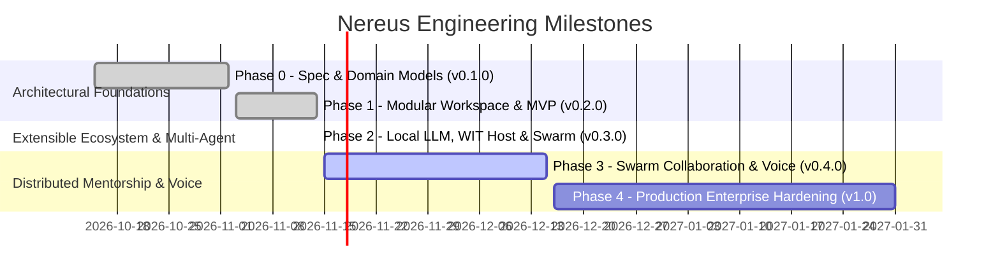

# 🗺️ Nereus Product & Engineering Roadmap

## 1. Vision & Trajectory

**Nereus 2.0** represents the definitive transition from experimental Python prototypes to a high-performance, single-binary, terminal-native AI coding cockpit built in **idiomatic Rust**.

The roadmap is structured into chronological engineering milestones, transitioning Nereus from initial architectural prototypes through its modular multi-agent ecosystem and onwards to distributed collaborative mentorship.

---

## 2. Milestone Breakdown

### Phase 0: Architecture Specification & Domain Models ✅
* **Version**: `v0.1.0` (Completed 2026-11-02)
* **Deliverables**:
  - Technical specification RFC and domain model definitions (`UserProfile`, `Roadmap`, `Assessment`).
  - Core algebraic state enum `LearningState` drafted.
  - License migrated to permissive MIT; branding assets created.
  - Legacy Python v1 repository permanently archived at `nereuslabs/nereus-v1`.

---

### Phase 1: Modular Workspace & Terminal MVP Release ✅
* **Version**: `v0.2.0` (Completed 2026-11-14)
* **Focus**: 9-crate Cargo workspace, compile-time algebraic FSM, and full Ratatui TUI cockpit.
* **Deliverables**:
  - Decoupled 9-crate Cargo workspace: `nereus-core`, `nereus-engine`, `nereus-agents`, `nereus-llm`, `nereus-sandbox`, `nereus-storage`, `nereus-tui`, `nereus-plugin`, `nereus-cli`.
  - Core algebraic state machine (`enum LearningState`) with deterministic Socratic threshold formula:
    $$\text{Threshold} = \min\left(70.0 + (\text{topic.difficulty} \times 15.0),\, 85.0\right)$$
  - 4 foundational pedagogical agents: `DiagnosticAgent`, `CoachAgent` (DAG topological sort), `TutorAgent`, and `ExaminerAgent`.
  - In-memory WebAssembly sandbox powered by `wasmtime` with strict fuel and memory caps, alongside host `rustc` compiler scratchpad.
  - Ratatui full-screen interactive cockpit: split panes, rotating Socratic Lighthouse, interactive diagnostic quiz, and syntax-highlighted editor.
  - SQLite session persistence with Write-Ahead Logging (WAL) mode and automated schema migrations.
  - Standardized Socratic Mentor Benchmark Suite (`nereus bench`).
  - Multi-platform packaging: npm binary launcher (`@nereuslabs/nereus`), Homebrew formula (`nereuslabs/tap/nereus`), and multi-arch GitHub Actions release pipeline.

---

### Phase 2: Extensible Pedagogical Ecosystem, Local Inference & Advanced Agents ✅
* **Version**: `v0.3.0` (Completed 2026-11-14)
* **Focus**: Static AST inspection, zero-cloud pure-Rust LLM inference, WebAssembly Component Model, and expanded multi-agent collaboration.
* **Deliverables**:
  - **AST-Level Static Code Analysis & Anti-Pattern Inspector** (`nereus-sandbox`):
    - `syn::visit` traversal detecting redundant `.clone()`, dangerous `.unwrap()`, unvetted `unsafe`, and C-style index loops with Socratic remediation hints.
  - **In-Process Local LLM Inference Engine** (`nereus-llm`):
    - Pure-Rust `LocalCandleClient` via Hugging Face `candle` tensor framework and native `OllamaClient` alongside cloud providers.
    - CLI provider switching (`nereus provider`) and in-cockpit runtime hot-switching (`Ctrl+P` / `F2`).
  - **Advanced Specialized Agents** (`nereus-agents`):
    - `LibrarianAgent`: Offline standard library and Rustonomicon search, compiler error citation mapping (`E0382`, `E0597`, etc.).
    - `AdversaryAgent`: Property-based educational fuzzing with boundary stress, arithmetic overflow, and concurrency race vectors.
  - **Ratatui Cockpit Editor Polish & UX** (`nereus-tui`):
    - Unbounded Undo/Redo ring buffer (`Ctrl+Z`, `Ctrl+Y`), dynamic line numbering, modal search (`Ctrl+F`), and full crossterm mouse integration.
  - **Full-Text Search & Git Journal Synchronization** (`nereus-storage`, `nereus-cli`):
    - SQLite FTS5 extension (`nereus search <query>`) and automated Git learning journal backups (`nereus sync`).
  - **WebAssembly Component Model Host** (`nereus-plugin`):
    - Canonical WIT specification (`nereus:curriculum@0.3.0`) for language-agnostic external curriculum packs.
    - Component binary header verification (`\0asm`) and sidecar manifest parser.
  - **Architecture Decision Records**: ADR 0011, ADR 0012, ADR 0013, ADR 0014.

---

### Phase 3: Distributed Swarm Collaboration & Socratic Voice Cockpit 🚀
* **Target Version**: `v0.4.0` (Target: Q4 2026)
* **Focus**: Multi-device synchronization, decentralized agent swarm, and real-time voice interaction.
* **Planned Deliverables**:
  - **Distributed Multi-Agent Swarm**: Blackboard pattern orchestration allowing parallel specialized agents (Compiler, Code Reviewer, Security Auditor, Performance Benchmarker) to critique code submissions concurrently.
  - **Socratic Voice Cockpit**: Real-time voice interaction over local Whisper STT and streaming TTS for conversational terminal coding drills.
  - **Language Server Protocol (LSP) Bridge**: Direct background communication with `rust-analyzer` to feed deep compiler diagnostics directly into `ExaminerAgent`.
  - **WebAssembly WASI Browser Cockpit**: Web-based zero-installation Nereus interactive terminal playground compiled to WASM.

---

### Phase 4: Production Enterprise Hardening & Enterprise Certifications 🛡️
* **Target Version**: `v1.0.0` (Target: Q1 2027)
* **Focus**: Team management, progress analytics dashboards, enterprise LMS SCORM export, and SOC2/ISO compliance.
* **Planned Deliverables**:
  - Multi-tenant organization progress tracking and cohort analytics dashboards.
  - Exportable proof-of-mastery cryptographically signed credentials.
  - Integration with corporate Git repositories (GitHub Enterprise, GitLab Self-Managed).

---

  Nereus Labs Product Roadmap • MIT License

