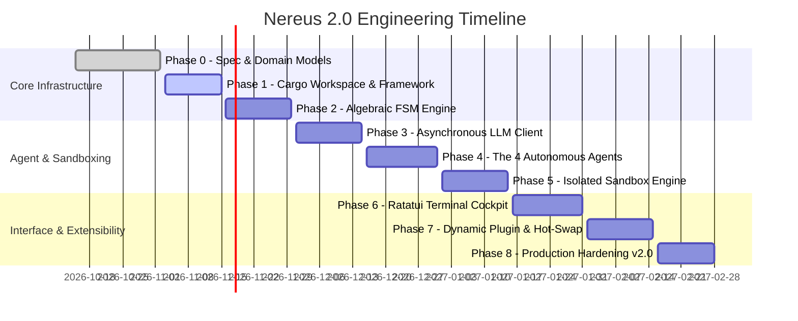

# 🗺️ Nereus 2.0 Product & Engineering Roadmap

## 1. Vision & Trajectory

**Nereus 2.0** represents the definitive transition from experimental Python prototypes to a high-performance, single-binary, terminal-native AI coding cockpit built in **idiomatic Rust**.

The roadmap is structured into 8 chronological engineering phases, taking Nereus from its initial architectural specification through to a hardened production release (`v2.0-stable`).

---

## 2. Phase Breakdown

### Phase 0: Architecture Specification & Domain Models ✅
* **Status**: Completed (v0.2.0-alpha)
* **Deliverables**:
  - Technical specification RFC and domain model definitions (`UserProfile`, `Roadmap`, `Assessment`).
  - Core algebraic state enum `LearningState` drafted.
  - License migrated to permissive MIT; branding assets created.
  - Python v1 repository permanently archived at `nereuslabs/nereus-v1`.

---

### Phase 1: Cargo Workspace & Modular Framework Skeleton 🚀
* **Target Version**: `v0.2.1-alpha`
* **Focus**: Decomposing monolithic crate into the 9-crate Cargo workspace.
* **Deliverables**:
  - `Cargo.toml` workspace root configuration.
  - Crates created: `nereus-core`, `nereus-engine`, `nereus-agents`, `nereus-llm`, `nereus-sandbox`, `nereus-storage`, `nereus-tui`, `nereus-plugin`, `nereus-cli`.
  - Common trait definitions moved into `nereus-core`.
  - Git worktree documentation and local directory scaffolding.

---

### Phase 2: Algebraic State Machine & Event Loop Engine
* **Target Version**: `v0.3.0-alpha`
* **Focus**: Pure state transition function and asynchronous event dispatch.
* **Deliverables**:
  - `nereus-engine` event loop implementation.
  - State persistence and rehydration protocol via `serde_json`.
  - Retry counter enforcement and diagnostic branching logic.
  - 100% hermetic unit tests verifying all state permutations.

---

### Phase 3: Multi-Provider Async LLM Client Layer
* **Target Version**: `v0.4.0-alpha`
* **Focus**: Unified asynchronous inference with zero-cost offline mocks.
* **Deliverables**:
  - Async `LLMClient` trait in `nereus-core`.
  - Deterministic `StubLLMClient` with scripted response patterns for hermetic testing.
  - Production `OpenRouterClient` supporting streaming SSE (`eventsource-stream`).
  - Structured output parsing with automatic repair retries on malformed JSON.

---

### Phase 4: The 4 Specialized Autonomous Agents
* **Target Version**: `v0.5.0-alpha`
* **Focus**: Deep implementation of agent logic in `nereus-agents`.
* **Deliverables**:
  - `DiagnosticAgent`: Adaptive question generator and weakness evaluator.
  - `CoachAgent`: Dependency-ordered milestone roadmap synthesizer.
  - `TutorAgent`: Concise theory authoring and dynamic retry revisions.
  - `ExaminerAgent`: Socratic feedback engine and dynamic passing score calculator:
    $$\text{Threshold} = \min\left(70.0 + (\text{topic.difficulty} \times 15.0),\, 85.0\right)$$

---

### Phase 5: Isolated Execution Sandbox (`nereus-sandbox`)
* **Target Version**: `v0.6.0-alpha`
* **Focus**: Real code compilation and sandboxed testing.
* **Deliverables**:
  - In-memory WebAssembly sandbox powered by `wasmtime` with fuel consumption limits.
  - Subprocess host runner with OS-level sandboxing (Linux namespaces / macOS sandbox-exec / Windows Job Objects).
  - Compiler error diagnostic parser (capturing Rust `E0xxx` codes, stack traces, and test output).
  - Integration with `ExaminerAgent` for execution-driven assessment.

---

### Phase 6: Ratatui Terminal Cockpit (TUI)
* **Target Version**: `v0.7.0-beta`
* **Focus**: Professional retro-modern terminal user interface.
* **Deliverables**:
  - 4-pane responsive terminal layout:
    * **Top-Left**: Interactive Roadmap Navigator.
    * **Top-Right**: Theory & Challenge Viewer.
    * **Bottom-Left**: Socratic Guidance & Lighthouse Feedback.
    * **Bottom-Right**: Code Input & Submission Cockpit.
  - Asynchronous event polling with Tokio channels (60 FPS rendering without stutter).
  - Retro cyber-ocean theme with custom ASCII lighthouse animations.

---

### Phase 7: Dynamic Plugin System & Hot-Swapping
* **Target Version**: `v0.8.0-beta`
* **Focus**: Dynamic module hot-reloading without session termination.
* **Deliverables**:
  - `ModuleRegistry` supporting in-memory dynamic trait swaps.
  - Native shared library (`.dylib`/`.so`) loader via `libloading` with ABI verification.
  - WebAssembly Component Model plugin host on `wasmtime`.
  - File-system watcher (`notify`) for automated hot-reloading during development.

---

### Phase 8: Production Hardening, SQLite Storage & v2.0-Stable Release
* **Target Version**: `v2.0.0`
* **Focus**: Enterprise resilience, SQLite persistence, and final release promotion.
* **Deliverables**:
  - SQLite session store with Write-Ahead Logging (WAL) and schema migrations.
  - Multi-platform release binaries (macOS ARM/x86, Linux x86/aarch64, Windows x64).
  - GitHub Actions CI/CD pipeline promoting to `main` via admin ruleset gates.
  - Comprehensive user guides, documentation verification, and release announcement.

---

## 3. Beyond v2.0: Future Horizons

* **Collaborative Terminal Pairing**: Multi-user terminal sessions over encrypted WebSockets.
* **Language Server Protocol (LSP) Bridge**: Embedding `rust-analyzer` and `clangd` diagnostics directly into the Socratic Examiner.
* **Local SLM Integration**: Zero-latency local execution using quantized Small Language Models via `llama.cpp` / `candle`.

---

  Nereus Labs Product Roadmap • v2.0 • MIT License

