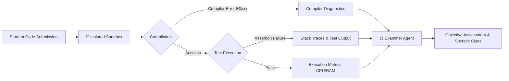

# 🧪 Nereus Execution Sandbox Engine

## 1. Philosophy: Execution-Driven vs Hallucinated Assessment

A fundamental flaw in existing AI coding tutors is their reliance on **pure textual LLM evaluation**. When an LLM is asked to review student code:

* It frequently hallucinates compiler errors that do not exist in the specified language version.
* It overlooks subtle concurrency race conditions, memory leaks, and off-by-one pointer errors.
* It cannot verify runtime performance, memory usage, or deterministic output under heavy test assertions.

**Nereus adopts an Execution-Driven Assessment model:**
Student code is **never** judged purely on appearance. It must be compiled and executed against a strict test suite inside an isolated sandbox. The resulting compiler diagnostics, stack traces, exit codes, and test assertions are captured and fed directly to the `ExaminerAgent`.



---

## 2. Sandbox Runner Architecture

The `nereus-sandbox` crate provides a unified trait abstraction (`SandboxRunner`) implemented by three distinct execution backends:

```rust
use async_trait::async_trait;
use serde::{Deserialize, Serialize};
use std::time::Duration;

#[derive(Debug, Clone, Serialize, Deserialize)]
pub struct ExecutionRequest {
    pub language: String,
    pub source_code: String,
    pub test_harness: String,
    pub timeout: Duration,
    pub memory_limit_mb: usize,
}

#[derive(Debug, Clone, Serialize, Deserialize)]
pub struct ExecutionResult {
    pub exit_code: i32,
    pub compiled_successfully: bool,
    pub compiler_output: String,
    pub stdout: String,
    pub stderr: String,
    pub execution_time: Duration,
    pub memory_used_bytes: usize,
}

#[async_trait]
pub trait SandboxRunner: Send + Sync {
    async fn execute(&self, request: ExecutionRequest) -> Result<ExecutionResult, crate::SandboxError>;
}
```

---

## 3. Runner Backend 1: In-Memory WebAssembly Sandbox (`Wasmtime`)

The premier execution runner compiles user code to WebAssembly (`wasm32-wasi`) and runs it in an in-memory `wasmtime` runtime instance.

### Security Guarantees
1. **Zero Host Access**: The WASM instance has no access to the host filesystem, environment variables, or network sockets unless explicitly bridged via virtual WASI pre-opens.
2. **Deterministic Fuel Metering**:
   Wasmtime's instruction fuel consumption prevents infinite loops and denial-of-service attempts.
   ```rust
   // Example fuel consumption configuration
   let mut config = wasmtime::Config::new();
   config.consume_fuel(true);
   
   let engine = wasmtime::Engine::new(&config)?;
   let mut store = wasmtime::Store::new(&engine, ());
   store.set_fuel(50_000_000)?; // Allow max 50 million instructions
   ```
3. **Linear Memory Caps**:
   Memory allocations are strictly bounded to 64MB per execution to prevent host memory exhaustion.

---

## 4. Runner Backend 2: Subprocess Host Runner

For languages that do not easily target WebAssembly (e.g. native C/C++ with OS threads, Python with C extensions), Nereus provides an isolated subprocess host runner.

### Operating System Isolation
* **Linux**: Spawns isolated processes using Linux namespaces (`CLONE_NEWPID`, `CLONE_NEWNET`, `CLONE_NEWNS`) and `cgroups v2` for memory and CPU pinning. Where available, leverages `bubblewrap` (`bwrap`) for unprivileged containerization.
* **macOS**: Leverages `sandbox-exec` with temporary seatbelt profiles restricting network sockets and limiting write operations to isolated `/tmp/nereus-*` directories.
* **Windows**: Wraps processes in Windows **Job Objects** configured with strict commit memory limits (`JOB_OBJECT_LIMIT_PROCESS_MEMORY`) and kill-on-close semantics.

### Hard Timeouts
Every execution is wrapped in an asynchronous Tokio timeout:

```rust
let execution_future = run_isolated_process(&command, &args);
match tokio::time::timeout(request.timeout, execution_future).await {
    Ok(result) => result,
    Err(_) => {
        kill_process_group(&child)?;
        Err(SandboxError::Timeout(request.timeout.as_secs()))
    }
}
```

---

## 5. Runner Backend 3: Deterministic Mock Runner (Hermetic CI)

To honor the **Zero API Cost & 100% Offline** invariant, Nereus provides `MockSandboxRunner` for hermetic test suites and local demos.

* Returns deterministic `ExecutionResult` fixtures based on code content:
  * Submissions containing `"fn main"` and `"assert"` return `compiled_successfully: true, exit_code: 0`.
  * Submissions containing syntax errors or intentional failure keywords trigger simulated compiler errors (e.g. `error[E0382]: use of moved value`).
* Runs with sub-millisecond execution times, enabling hundreds of integration tests to execute in under one second.

---

## 6. Examiner Feedback Integration

When the execution completes, `ExecutionResult` is synthesized into the Examiner's prompt context:

```json
{
  "compiled_successfully": false,
  "exit_code": 101,
  "compiler_output": "error[E0382]: borrow of moved value: `buffer`\n  --> src/main.rs:18:9\n   |\n16 |     let buffer = vec![0u8; 1024];\n   |         ------ move occurs because `buffer` has type `Vec<u8>`, which does not implement the `Copy` trait\n17 |     process_buffer(buffer);\n   |                    ------ value moved here\n18 |     buffer.clear();\n   |     ^^^^^^ value borrowed here after move",
  "test_assertions_passed": 0,
  "test_assertions_failed": 1
}
```

The Examiner parses the exact compiler code (`E0382`) and lines, anchoring its Socratic guidance to the reality of the compiler rather than an abstract hallucination.

---

<div align="center">
  <sub>Nereus Labs Sandbox Engine Specification • v2.0 • MIT License</sub>
</div>
