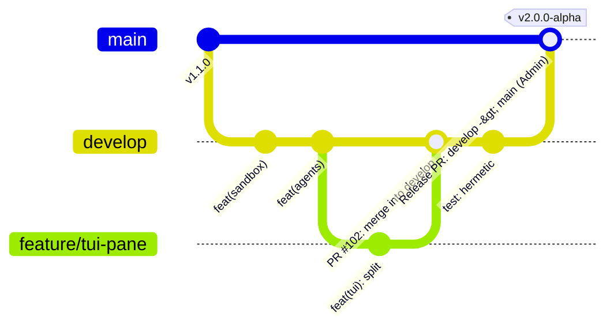
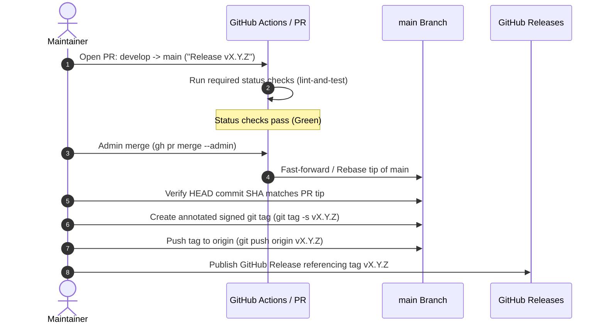

# 🏷️ Versioning, Governance & Release Protocol

## 1. Semantic Versioning Specification (SemVer 2.0)

Nereus strictly adheres to **[Semantic Versioning 2.0.0](https://semver.org/)** (`vMAJOR.MINOR.PATCH`):

* **MAJOR**: Incompatible architectural or API changes (e.g. migrating from Python v1.x to Rust v2.x, or breaking FSM state serialization formats).
* **MINOR**: Backward-compatible new capabilities (e.g. adding a new execution sandbox runner, adding a new specialized agent, or adding an interactive TUI pane).
* **PATCH**: Backward-compatible bug fixes, performance optimizations, and documentation corrections.

Pre-release releases append a hyphen and a series identifier (e.g. `v0.2.0-alpha.1`, `v2.0.0-rc.1`).

---

## 2. GitHub Flow & Branching Topology

The Nereus organization operates a two-tiered branching model designed for continuous integration with strict release gates:



### Branch Responsibilities
1. **`feature/*` or `fix/*`**:
   Short-lived developer branches cut from `develop`. All feature work occurs here (frequently inside isolated Git Worktrees).
2. **`develop` (The Integration Fast Lane)**:
   The primary trunk where all tested features land. Every pull request targeting `develop` must pass the full CI suite (`cargo fmt`, `cargo clippy`, `cargo test`). History is linear (squash or rebase merge).
3. **`main` (The Production Release Gate)**:
   Reflects the verified, production-ready release state. Direct pushes to `main` are strictly forbidden. Only promotion pull requests from `develop` are merged into `main`.

---

## 3. GitHub Repository Ruleset Governance

The `main` branch is governed by a **GitHub Repository Ruleset** (`id=20506063`, source `nereuslabs/nereus`).

### Active Ruleset Constraints
* **`deletion`**: Deletion of the `main` branch is blocked for all users.
* **`non_fast_forward`**: Force-pushing (`git push --force`) to `main` is categorically rejected.
* **`pull_request`**:
  * Minimum of 1 approved pull request review required.
  * Required status check: `lint-and-test` (must report success).
  * Enforce linear commit history.

> [!CAUTION]
> **Ruleset Scope & Admin Access**:
> The ruleset cannot be managed or modified by personal access tokens lacking the `manage_rulesets` scope. Direct pushes are rejected even for organization administrators unless an admin-bypass rule actor is explicitly designated.

---

## 4. The Release Promotion Protocol

Promoting a release from `develop` into `main` follows a deterministic 6-step protocol:



### Step-by-Step Instructions

#### 1. Open the Release PR
```bash
gh pr create \
  --base main \
  --head develop \
  --title "Release vX.Y.Z" \
  --body "Release promotion from develop to main. Includes changelog and verified test gates."
```

#### 2. Verify CI Checks
Ensure that the `lint-and-test` status check succeeds on the PR.

#### 3. Merge via Admin Bypass
```bash
gh pr merge -R nereuslabs/nereus --rebase --admin
```

#### 4. The Critical v1.1.0 Rebase Lesson
> [!IMPORTANT]
> **The v1.1.0 Lesson on SHA Rewriting:**
> When using `--rebase --admin`, GitHub rewrites commit SHAs on `main`. Never tag the local `develop` branch before merging!
> Always fetch the freshly updated `main` tip, verify that `git rev-list -n1 vX.Y.Z == main`, and apply the tag directly to `origin/main`'s commit SHA.

```bash
# Fetch the updated main branch
git fetch origin main
git checkout main
git pull --ff-only origin main

# Verify the tip SHA
MAIN_TIP=$(git rev-parse HEAD)
echo "Main tip SHA: $MAIN_TIP"
```

#### 5. Annotate, Sign and Push the Release Tag
```bash
# Create annotated signed tag
git tag -s "vX.Y.Z" -m "Nereus Release vX.Y.Z" "$MAIN_TIP"

# Verify tag points exactly to main tip
test "$(git rev-list -n1 vX.Y.Z)" = "$MAIN_TIP" && echo "Tag verification: PASSED"

# Push tag to GitHub
git push origin "vX.Y.Z"
```

#### 6. Publish the GitHub Release
```bash
gh release create "vX.Y.Z" \
  --target main \
  --title "🌊 Nereus vX.Y.Z" \
  --notes-file RELEASE_NOTES.md
```

---

<div align="center">
  <sub>Nereus Labs Governance & Release Protocol • v2.0 • MIT License</sub>
</div>
